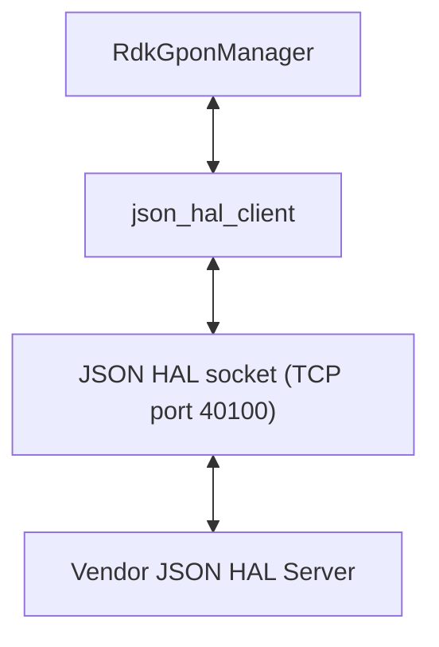

# RdkGponManager

`RdkGponManager` is the RDK-B middleware component that owns Gigabit-capable Passive Optical Network
(`GPON`) state on a fibre gateway. It presents the Optical Network Termination (`ONT`) to the rest of
RDK-B as a `TR-181` data-model surface under `Device.X_RDK_ONT`, and translates reads and writes on
that surface into requests on a `JSON` HAL that a vendor implements.

The `GPON` HAL differs structurally from most RDK-B HALs: it is **not** a C header, and no library is
linked across the HAL boundary. The contract is a `JSON` Schema, and the two participants are
separate processes exchanging messages over a `TCP` socket. That is why there is no separate
`rdkb-halif-gpon` repository: the interface contract lives here, beside the manager that speaks it.
Everything else in this repository is the manager middleware around that contract.

## Documentation

The HAL contract is specified in the documents below, which are its authority:

| Document | What it covers |
| --- | --- |
| [`docs/pages/halSpec.md`](docs/pages/halSpec.md) | The `GPON` `JSON` HAL interface specification — architecture, initialization and startup, threading, process and memory models, blocking behaviour, error handling, the non-functional requirements, and the complete action and object surface. |
| [`docs/pages/halSpecDetailed.md`](docs/pages/halSpecDetailed.md) | The per-parameter reference — every `TR-181` parameter with its type, constraint, access and description, plus the object index, the enumeration appendix, worked message examples and the known contract defects. |
| [`CHANGELOG.md`](CHANGELOG.md) | Release history, and the distinction between the repository release tag and the HAL schema version. |

The documentation is generated by `docs/generate_docs.sh`, which clones the `rdkcentral/hal-doxygen`
generator at tag `1.2.0` into `docs/build` and writes HTML into `docs/output/html`. Both directories
are excluded from version control [`docs/.gitignore`], so the Markdown sources above are the files to
read. `docs/pages/` also carries five symlinks — `CHANGELOG.md`, `CONTRIBUTING.md`, `COPYING.md`,
`LICENSE.md` and `NOTICE.md` — to the corresponding root files, so the generator renders them beside
the specification.

## Architecture

`RdkGponManager` is the **client** of the interface, through the `json_hal_client` library, and the
vendor supplies the **server** [`source/TR-181/middle_layer_src/gponmgr_dml_hal.c`].
`RdkGponManager` is itself the owning service, so no other middleware service sits between the rest
of RDK-B and this interface. The loopback address is fixed by the transport, which defines
`SERVER_HOST` as `127.0.0.1`
[[`tcp_client.h`](https://github.com/rdkcentral/json-hal-library/blob/86a0a300b976f8e3295064af8fb3fd1c793c9e64/tcp_client.h)].

## JSON HAL contract

**Module Identity:** Messages carry the module name `gponhal` and the schema version `0.0.1`, both
fixed as constants in both shipped schemas [`definitions.moduleName.const`,
`definitions.schemaVersion.const`], and the client reads both from the schema file it loads
[[`json_hal_load_config`](https://github.com/rdkcentral/json-hal-library/blob/86a0a300b976f8e3295064af8fb3fd1c793c9e64/json_hal_common.c)].
The schema states that the version must not be modified and that HAL operation requires the correct
supported version, so the client and the vendor server must agree on it. The schema version advances
independently of the repository release tags recorded in [`CHANGELOG.md`](CHANGELOG.md), the most
recent of which is `v1.7.0`.

**Object Tree:** Every parameter sits under the `TR-181` vendor extension `Device.X_RDK_ONT`, across
seven segments — `PhysicalMedia` (36 parameters), `Gem` (18), `Veip` (13), `Ploam` (10), `Gtc` (8),
`Omci` (3) and `TR69` (2), for a total of 90 in `hal_schema/gpon_hal_schema.json`. The manager
addresses each segment through a `GPON_QUERY_*` definition
[`source/TR-181/middle_layer_src/gponmgr_dml_hal.c`], and
[`docs/pages/halSpecDetailed.md`](docs/pages/halSpecDetailed.md) documents each parameter within
them.

**Actions:** The `action` enumeration carries eleven members [`definitions.action`], of which eight
bind a payload. `docs/pages/halSpec.md` names them all and records which are unsupported under the
shipped schema.

**Transport:** The interface is carried by the `json-hal-library` client and server, which are the
authority for the message envelope and the client semantics:
[rdkcentral/json-hal-library@`86a0a300`](https://github.com/rdkcentral/json-hal-library/tree/86a0a300b976f8e3295064af8fb3fd1c793c9e64).

## Variant selection

**Shipped Schema Variants:** Two schemas are shipped, both consumed by `RdkGponManager` and by no
other component, and a build loads exactly one of them:

| Schema | Parameter definitions | Loaded when |
| --- | --- | --- |
| [`gpon_hal_schema.json`](hal_schema/gpon_hal_schema.json) | 90 | `WAN_MANAGER_UNIFICATION_ENABLED` is not defined |
| [`gpon_wan_unify_hal_schema.json`](hal_schema/gpon_wan_unify_hal_schema.json) | 95 | `WAN_MANAGER_UNIFICATION_ENABLED` is defined |

Selection takes two steps: the flag sets `GPON_MANAGER_CONF_FILE`, the configuration file
`RdkGponManager` passes to `json_hal_client_init`
[`source/TR-181/middle_layer_src/gponmgr_dml_hal.c`], and that file names the schema. The variant
adds five `PhysicalMedia` parameters — `Alias`, `Enable`, `LastChange`, `LowerLayers` and
`Upstream` — and makes `Enable`, `Alias` and `LowerLayers` writable, taking the writable surface from
8 parameters to 11. [`Variability Management`](docs/pages/halSpec.md#variability-management) and
[`Platform or Product Customization`](docs/pages/halSpec.md#platform-or-product-customization) in
`docs/pages/halSpec.md` set out the selection and its effects, and
[`docs/pages/halSpecDetailed.md`](docs/pages/halSpecDetailed.md) marks each variant-only parameter in
place.

## Repository layout

| Path | Contents |
| --- | --- |
| `hal_schema/` | The two `JSON` Schema contracts and eight `example_*_msg.json` message fixtures. |
| `config/` | [`RdkGponManager.xml`](config/RdkGponManager.xml), the `TR-181` data-model description, and the two client configuration files. |
| `source/GponManager/` | The service host — process entry point, message-bus interface, controller, and the manager's own link state machine (internal middleware state, not part of the HAL contract). |
| `source/TR-181/` | [`include/gpon_apis.h`](source/TR-181/include/gpon_apis.h) and `middle_layer_src/`, the data-model middle layer that translates `TR-181` access into `JSON` HAL requests. |
| `cfg/` | Autotools support directory, named by `AC_CONFIG_AUX_DIR` and `AC_CONFIG_MACRO_DIR`. |
| `docs/` | The documentation described above. |

## Building

The component builds with Autotools. `configure.ac` declares the package `RdkGponManager-rdkb` (its
`AC_INIT` string is a package identifier, not a release version), initialises Automake and Libtool,
and generates the makefiles for `source/` and its subdirectories; the root [`Makefile.am`](Makefile.am)
declares `SUBDIRS = source`.

**Build Options:** One is exposed: `--enable-notify` adds `-DENABLE_SD_NOTIFY` and links `-lsystemd`
for systemd readiness notification [`configure.ac`]. A `GITVERSION` macro records
`git describe --tags --always --dirty` into the substituted `GIT_VERSION` [`configure.ac`].

**Dependencies:** The makefiles declare the libraries: the middle layer links `-lccsp_common`,
`-lhal_platform`, `-ljson_hal_client`, `-ljson-c`, `-lpthread` and `-lsyscfg`
[`source/TR-181/middle_layer_src/Makefile.am`].

## Known contract defects

Three defects affect a caller of this component;
[`docs/pages/halSpecDetailed.md`](docs/pages/halSpecDetailed.md#contract-defects) carries the
schema-level inventory.

1. **Object Deletion:** `deleteObject` is unusable under both shipped schemas. Its payload
   definition is an empty `anyOf`, so no schema-valid delete message exists; see
   [API Surface](docs/pages/halSpec.md#api-surface).
2. **Instanced Prefixes:** The bare prefixes `Device.X_RDK_ONT.PhysicalMedia.`,
   `Device.X_RDK_ONT.Gem.` and `Device.X_RDK_ONT.Veip.` are not addressable without an instance
   number, so a bulk read names one instance, such as `Device.X_RDK_ONT.PhysicalMedia.1.`, rather
   than the bare prefix.
3. **Shipped Example Messages:** `hal_schema/example_getParameters_msg.json` fails both schemas, and
   `hal_schema/example_getSchemaResponse_msg.json` returns the xTM schema path
   `/etc/rdk/hal_schemas/xtm_hal_schema.json` rather than a `GPON` one.

## Contributing

Contributions are made by forking the repository and opening a pull request; RDK requires a signed
RDK Contributor License Agreement before code is accepted into the project
[[`CONTRIBUTING.md`](CONTRIBUTING.md)]. Review is routed to `@rdkcentral/wanmanager-maintainers`, the
default owner for every path in the repository [`.github/CODEOWNERS`].

## Licence

This component is licensed under the Apache License, Version 2.0. The full text is in
[`LICENSE`](LICENSE) and the attribution notices are in [`NOTICE`](NOTICE).
