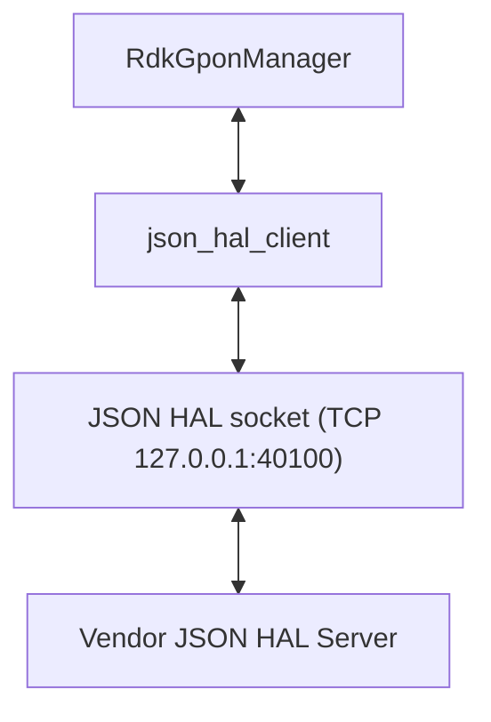
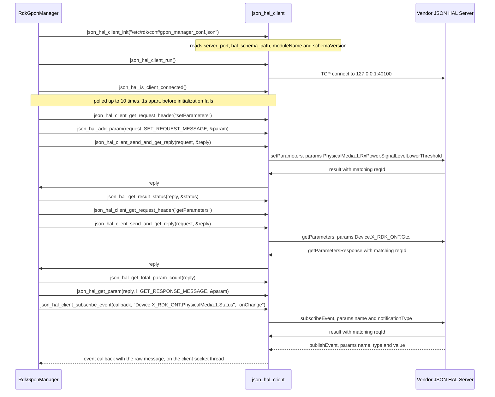

# GPON HAL Documentation

## Version History

| Date | Comment | Version |
| --- | --- | --- |
| 2026-08-24 | Initial release. Specifies the GPON `JSON` HAL contract carried by `hal_schema/gpon_hal_schema.json` and by its build-selected variant `hal_schema/gpon_wan_unify_hal_schema.json`, recorded as an `Unreleased` entry in `CHANGELOG.md`. | 1.0.0 |

## Acronyms

- `ACS` \- Auto Configuration Server, the remote management server a `TR-069` agent contacts
- `FEC` \- Forward Error Correction
- `GEM` \- `GPON` Encapsulation Method, the frame format carrying user traffic over the `PON`
- `GPON` \- Gigabit-capable Passive Optical Network
- `GTC` \- `GPON` Transmission Convergence, the framing sub-layer between the `PON` and `GEM`
- `HAL` \- Hardware Abstraction Layer
- `IPC` \- Inter-Process Communication
- `ITU-T` \- International Telecommunication Union Telecommunication Standardization Sector
- `JSON` \- JavaScript Object Notation
- `JSON-RPC` \- The remote procedure call convention carried over `JSON`, used by this HAL's transport
- `MIC` \- Message Integrity Check, the integrity field on an `OMCI` message
- `OMCI` \- `ONT` Management and Control Interface
- `ONT` \- Optical Network Termination, the subscriber-side endpoint this interface models
- `ONU` \- Optical Network Unit, the term the `ITU-T` recommendations use for the same endpoint
- `PLOAM` \- Physical Layer Operations, Administration and Maintenance
- `PON` \- Passive Optical Network
- `RDK-B` \- Reference Design Kit for Broadband Devices
- `TCP` \- Transmission Control Protocol
- `TR-069` \- Broadband Forum Technical Report 069, the CPE WAN management protocol
- `TR-181` \- Broadband Forum Technical Report 181, which defines the `Device:2` root data model
- `VEIP` \- Virtual Ethernet Interface Point, the `OMCI` managed entity bridging `PON` to Ethernet
- `VLAN` \- Virtual Local Area Network

## Description

The diagram below describes a high-level software architecture of the GPON HAL module stack.



The GPON HAL is the interface between `RdkGponManager` and a vendor's `GPON` implementation. It
differs from most HALs in `RDK-B` in one structural respect: **it is not a C header, and no library
is linked across the HAL boundary.** The contract is a `JSON` Schema, the two participants are
separate processes, and they exchange messages over a loopback `TCP` socket. The contract lives in
this repository, beside the manager that speaks it, and the per-parameter detail that inline
documentation carries for a C HAL is in [halSpecDetailed.md](halSpecDetailed.md).

**Each schema is consumed by `RdkGponManager` and by no other component.** The repository ships two
schemas, `hal_schema/gpon_hal_schema.json` and `hal_schema/gpon_wan_unify_hal_schema.json`, and a
build loads exactly one of them: `WAN_MANAGER_UNIFICATION_ENABLED` selects the client configuration
file, and that file names the schema, as `Variability Management` sets out. `RdkGponManager` is the
**client** of the interface, through the `json_hal_client` library, and the vendor supplies the
**server**. The manager is also the owning middleware service, so no other `RDK-B` component sits
between it and the HAL. The rest of `RDK-B` sees `GPON` state as a consumer of the manager's
`TR-181` data model under `Device.X_RDK_ONT`, which the manager translates into `JSON` HAL requests.

**The object tree is a vendor extension, not a Broadband Forum model.** Every parameter lives under
`Device.X_RDK_ONT`, and the `X_` prefix marks an extension to the `TR-181` `Device:2` root data
model rather than a branch the Broadband Forum defines. The published model this repository was
checked against is `Device:2.21` — the Broadband Forum `Device:2` root data model at release
`2.21`, published as
[`TR-181 Device:2, release 2.21`](https://cwmp-data-models.broadband-forum.org/tr-181-2-21-0-cwmp.html)
— which supplies the interface-object conventions the schema borrows. Parameter semantics come from
the optical standards the schema descriptions cite — `ITU-T G.988` for the `OMCI` managed entities
and their counters, and `ITU-T G.9807` for three `GTC` error counters — and from the manager's
`TR-181` data-model description, `config/RdkGponManager.xml`.

The interface covers the optical transceiver and its alarms (`PhysicalMedia`), `GEM` port and
Ethernet flow mapping including `VLAN` tag handling (`Gem`), the `VEIP` interface and its Ethernet
flows (`Veip`), the `PLOAM` registration state and its timers (`Ploam`), `GTC` framing and `FEC`
counters (`Gtc`), `OMCI` message and `MIC` error counts (`Omci`), and the `ACS` address and
associated tag handed from the `OMCI` domain to the `TR-069` domain (`TR69`). `API Surface` lists
the seven segments with their parameter counts.

`GPON` is not available on the `HUB6` or `XER10` reference platforms, so the behaviour stated here
rests on the shipped schemas, the client configuration, the manager source and the pinned transport
library rather than on observation of a running HAL.

Diagrams are fenced `mermaid` blocks. They render on GitHub; the generated documentation site shows
their source text, keeps a fixed-width navigation pane that leaves little room on a narrow viewport,
and scrolls wide tables horizontally, so GitHub is the better surface for reading this page.

## Optional Components

**The `wan_unify` schema variant is the only optional component.** `Platform or Product
Customization` sets out what it adds — five `PhysicalMedia` parameters, three of them writable — and
`Variability Management` how a build selects it.

**No transport, action or notification type is optional.** Both schemas declare the same eleven
actions, the same nine enumerations and the same eighteen entries in `subscribeEventSupportedList`.
The one list the schemas mark as optional is `getParameterOptionalList`, which holds 24 read paths —
the 21 `Gem` Ethernet-flow entries and the three `TR69` entries. A vendor that does not implement one
of them answers `Not Supported`, as `Internal Error Handling` describes. The companion
`setParameterOptionalList` is an empty `anyOf` in both schemas, a defect in the shipped contract
rather than an option; [halSpecDetailed.md](halSpecDetailed.md) records it under `Contract Defects`.

## Component Runtime Execution Requirements

The client side of this interface is the `json_hal_client` library linked into `RdkGponManager`; the
server side is a separate vendor process. The requirements below apply to the caller of the client
library and, where stated, to the vendor server.

### Initialization and Startup

**Three steps, in this order, and the third is not optional.** `RdkGponManager`'s bring-up is the
reference sequence:

1. `json_hal_client_init()` with the path of the client configuration file, from which the client
   reads the server port and the schema path.
2. `json_hal_client_run()`, which starts the client socket thread.
3. Poll `json_hal_is_client_connected()` until it reports a connection. The manager polls up to ten
   times, one second apart, and fails its initialization if no connection is established in that
   window.

Step 3 is required because the socket connects asynchronously on the thread step 2 starts: a request
issued immediately after step 2 may go into an unconnected client.

**The schema file is a runtime dependency of the client.** Step 1 opens the schema the configuration
names and takes `definitions.moduleName.const` and `definitions.schemaVersion.const` from it, and
every request header the client builds carries those values as `module` and `version`.
Initialization fails if the schema file is missing or unreadable. Both GPON schemas declare `module`
`gponhal` and `version` `0.0.1`, so a variant mismatch between manager and vendor is invisible in the
envelope and surfaces later as an unrecognised parameter name.

**No initialization message is sent.** The first message a vendor server receives is an ordinary
request.

**The client entry points**, all declared by `json-hal-library` (see `Build Requirements`):

- `json_hal_client_init()` — read the configuration and the schema, and prepare the client
- `json_hal_client_run()` — start the client socket thread
- `json_hal_is_client_connected()` — test whether the socket is connected
- `json_hal_client_get_request_header()` — build an envelope for a named action
- `json_hal_add_param()` — append a parameter entry to a request's `params` array
- `json_hal_client_send_and_get_reply()` — send and wait for the correlated reply
- `json_hal_client_send_and_get_reply_with_timeout()` — the same, with a caller-supplied wait
- `json_hal_client_subscribe_event()` — register a callback and subscribe one event
- `json_hal_get_result_status()` — read `Result.Status` out of a reply
- `json_hal_get_total_param_count()` and `json_hal_get_param()` — walk a reply's `params` array
- `json_hal_client_terminate()` — tear the client down

`RdkGponManager` never calls `json_hal_client_terminate()`, so its socket lives as long as the
process.

**Vendor obligation.** The server listens before, or shortly after, the client starts, and accepts a
reconnection without operator intervention. A server that is not accepting connections within the
client's ten-second window causes `RdkGponManager` initialization to fail.

### Threading Model

**The client library owns the socket thread.** `json_hal_client_run()` starts a dedicated thread that
owns the socket and runs the receive loop; a caller's own thread never touches the socket.

**Event callbacks run on that thread, with the transport's subscription lock held.** The callback
registered through `json_hal_client_subscribe_event()` receives the raw event message and its length,
and is invoked while the client holds its non-recursive subscription lock. Four rules follow for
every callback:

- **Do not make a synchronous HAL call from a callback.** Only the receive thread completes or
  expires a pending request, and the callback is occupying it, so the call deadlocks rather than
  timing out. Queue the work to a caller-owned thread.
- **Do not subscribe, re-subscribe or terminate the client from a callback.** Each takes the
  subscription lock the dispatch already holds, and deadlocks.
- **Copy what the callback needs before it returns.** The message buffer belongs to the event's
  `JSON` object, which is released as soon as the callback returns.
- **Return promptly.** While a callback runs, no reply is delivered, no request timeout advances and
  no other event is dispatched.

**Issue HAL requests from one thread, or serialise them behind a lock the caller owns.** The client
gives each request its own tracking record and condition variable, so it does not queue concurrent
callers, and it appends to its pending-request list without holding the lock the receive thread
takes while it traverses that list. Several parameters in one `params` array, within the request
bound in `Memory Model`, cost one exchange; batching is the way to reduce round trips.
`RdkGponManager` reaches the HAL from both its link state machine thread and its `TR-181` handler
path, and a new caller should not take that arrangement as a model of safe concurrent use.

**Vendor obligation.** The server serves a single long-lived client connection carrying sequential
requests, stamps every reply with the `reqId` of the request it answers, and does not require a
caller to hold more than one request open at a time.

### Process Model

**Two processes across a socket, not a library linked into one.** A C HAL is a shared object loaded
into the calling process; here the vendor implementation is a **separate process** reached over
`TCP`, so:

- The two sides start, stop and fail independently, and either may be restarted under the other.
- A HAL call is an `IPC` round trip that can fail for transport reasons unrelated to the parameter.
  Every call site handles a transport failure separately from a `Failed` result status.
- Loss of the connection is an ordinary state, observable through `json_hal_is_client_connected()`.
  When the server closes the connection, the client socket thread returns to its connect step and
  retries once a second until the server accepts.

**The exchange is `JSON-RPC` style over `TCP`**: a request names an action, and the reply that
answers it is matched to the request by `reqId` rather than by position on the connection.

**The socket is loopback-only.** The client connects to `127.0.0.1` and takes only the port from its
configuration file, so the vendor server listens on the loopback interface on port `40100`, on the
same device as the manager.

**Both sides take the port from the same configuration file**, so they agree on it without a
discovery step. The server's listen backlog is 32 connections. `API Surface` gives the direction of
every action.

### Memory Model

No memory is shared across the HAL boundary: what crosses it is a serialized `JSON` document. The
memory a caller manages is local, and consists of two `json_object` handles per exchange. The
**request** is created by the caller, normally with `json_hal_client_get_request_header()`, which
returns an object already carrying `module`, `version`, `action` and `reqId` and, for every action
except `getSchema`, an empty `params` array. The **reply** is created by the client library and
returned through the out-parameter of `json_hal_client_send_and_get_reply()`. Both are released with
the `json-c` reference-count release, `json_object_put()`.

#### Caller Responsibilities

- **Release the request on every path.** The client library never takes ownership of it, whether
  the exchange succeeds or fails.
- **Initialise the reply handle to `NULL`, and release it only when it is set.** The library assigns
  it only after a completed exchange, and assigns `NULL` when the received document does not parse,
  so a caller tests the handle rather than the return code alone. A failed exchange leaves no reply
  object to release.
- **Copy values out of a reply before releasing it.** Values read with `json_hal_get_param()` are not
  valid once the reply is released.
- **Build a new request for every send.** Correlation needs a fresh `reqId` per exchange, and the
  header helper allocates one per call.
- **Keep each request within 16384 bytes.** The server reads a request in one 16384-byte receive and
  discards, without a reply, a request that does not arrive whole, and the client's send loop can
  return before the whole request is written. A caller with a large batch splits it into several
  requests. Replies carry no such bound: the client reassembles a long reply from successive reads.
- **Zero-terminate every string placed in a request**, since the transport serializes parameter
  fields as C strings.

#### Module Responsibilities

- The client library owns the receive buffer, the reassembly of a reply that spans several reads,
  the request-identifier counter and the per-request tracking record, which it frees when the
  exchange completes or expires. Reassembly ends at the first short read, and
  [halSpecDetailed.md](halSpecDetailed.md) records that framing limit under `Contract Defects`.
- The library transfers ownership of the reply handle to the caller and never takes ownership of
  the request handle.
- The vendor server owns everything on its side of the socket, assumes nothing about what a
  disconnected client released, and serves a fresh connection from a restarted manager.
- The process boundary isolates allocations, not data. Received names and values reach the manager's
  parsing path, where some are copied into fixed buffers without always being bounded;
  [halSpecDetailed.md](halSpecDetailed.md) records those copies under `Contract Defects`.

### Power Management Requirements

**This interface carries no power-management function.** No action or parameter in either schema
requests a power state or a power transition: the vocabulary reads and writes optical, registration
and counter parameters only. The writable `PhysicalMedia` signal-level thresholds set optical alarm
thresholds, as the `ITU-T G.988` clauses cited in their descriptions define them, and not transmit
power.

### Asynchronous Notification Model

**One subscription mechanism, two message flows.** A caller subscribes with `subscribeEvent`, which
the server acknowledges with `result`; the server then sends `publishEvent` unsolicited whenever the
subscribed parameter meets the notification condition. The vocabulary has no unsubscribe action.
Callbacks run as `Threading Model` describes and follow its four rules.

**Required fields differ between the two messages.** A `subscribeEvent` parameter entry carries
`name` and `notificationType` and no value. A `publishEvent` parameter entry carries `name`, `type`
and `value`, so a receiver can interpret the value without looking the parameter up.

**The `notificationType` value is `interval` or `onChange`, with `onChange` as the default.** The transport
also defines `onChangeSync` and `onChangeSyncTimeout` behind its `JSON_BLOCKING_SUBSCRIBE_EVENT`
compile guard. Neither belongs to this contract: a subscription requesting one is not a valid message
on this interface, and a GPON vendor server need not support them. `RdkGponManager` subscribes with
`onChange`.

**Eighteen parameters can be published, and only two of them can be subscribed to.**
`subscribeEvent` and `publishEvent` bind their `params` items to the eighteen entries of
`subscribeEventSupportedList`, identical in both variants. A `subscribeEvent` entry also requires
`notificationType`, and only `ontPhysicalMediaStatus` and `ontVeipAdministrativeState` declare that
property, so a validating server rejects a subscription naming any of the other sixteen while
accepting a `publishEvent` for all eighteen.

| Group | Parameters | Valid in `subscribeEvent` |
| --- | --- | --- |
| Optical status | `Device.X_RDK_ONT.PhysicalMedia.{i}.Status` | **Yes** |
| Optical alarms (14) | `Device.X_RDK_ONT.PhysicalMedia.{i}.Alarm.` `RDI`, `PEE`, `LOS`, `LOF`, `DACT`, `DIS`, `MIS`, `MEM`, `SUF`, `SD`, `SF`, `LCDG`, `TF`, `ROGUE` | No — the definitions declare no `notificationType` property |
| Registration | `Device.X_RDK_ONT.Ploam.RegistrationState` | No — same reason |
| `VEIP` administrative state | `Device.X_RDK_ONT.Veip.{i}.AdministrativeState` | **Yes** |
| `VEIP` operational state | `Device.X_RDK_ONT.Veip.{i}.OperationalState` | No — same reason |

`Ploam` is a singleton, so its path has no instance number; `PhysicalMedia` and `Veip` are indexed,
and the alarm leaf names are upper case exactly as written above.

**The sixteen that cannot be subscribed to are polled.** A caller reads them with `getParameters`,
and does not treat a lack of events for them as a sign that their value is unchanged.
`RdkGponManager` itself issues three subscriptions that a validating server rejects;
[halSpecDetailed.md](halSpecDetailed.md) records them with the defect.

**Current state is read, not awaited.** A caller that needs a current value reads it with
`getParameters` rather than waiting for an event, and re-subscribes after a reconnection. The client
keeps its subscription list across a dropped connection and appends a repeated subscription rather
than replacing the first, so a callback registered twice runs twice per event: a caller that
re-subscribes uses an idempotent handler, or terminates and re-initializes the client first.

**A subscription's status cannot be read.** `json_hal_client_subscribe_event()` releases the `result`
without inspecting `Result.Status`, so a subscription refused with `Failed`, `Invalid Argument` or
`Not Supported` returns to the caller exactly as an accepted one does. The arrival of a
`publishEvent` is the only evidence that a subscription is live.

**The `getActiveSubscriptions` action cannot enumerate subscriptions.** Neither it nor
`getActiveSubscriptionsResponse` binds a payload, so the response is the bare four-field envelope,
and the transport provides no helper for either action. A caller keeps its own record of what it
subscribed to, as `RdkGponManager` does by subscribing from a fixed list at startup, and treats any
extra content in a response as a vendor extension.

**Vendor obligation.** The server acknowledges every `subscribeEvent` with a `result`, publishes only
the parameters in the table above with all three required fields populated, and does not require a
`getActiveSubscriptions` exchange to establish or maintain a subscription.

### Blocking calls

Send-and-reply calls are synchronous: each blocks the calling thread until the matching reply arrives
or its wait budget runs out, so HAL requests are not issued from a thread with latency obligations of
its own. `json_hal_client_send_and_get_reply()`, the form `RdkGponManager` uses for every request,
waits 40 ticks of the client's receive loop, about 10 seconds on a quiet connection, and
`json_hal_client_send_and_get_reply_with_timeout()` converts its seconds argument at four ticks per
second and clamps the result to between 40 and 480 ticks, about 10 to 120 seconds. A tick is one pass
of the receive loop, so traffic on the connection spends the budget faster and reassembly of a large
reply pauses it, and neither figure is a precise deadline. Connection establishment blocks for up to
ten one-second polls, as `Initialization and Startup` describes, and event delivery through
`publishEvent` is the only asynchronous path in the interface.

### Internal Error Handling

**Two kinds of failure, reported differently.** A **transport failure** is a send-and-reply call
that fails: the request may never have been processed. An **application failure** is a reply whose
`Result.Status`, read with `json_hal_get_result_status()`, is not `Success`: the request was
processed and refused. A caller handles the two separately.

`Result.Status` takes one of four values from `definitions.resultStatusEnumList`, written exactly as
shown, spaces included:

| Status | Meaning | What the caller should do |
| --- | --- | --- |
| `Success` | The request was accepted and applied. | Proceed. For a write, success means the vendor accepted the value, not that dependent optical or registration state has settled; re-read the parameter when the settled value matters. |
| `Failed` | The request was understood but could not be applied. | Do not retry blindly, since the same request usually fails again. Log the parameter path and the status, and report the failure upward. |
| `Invalid Argument` | A parameter name, type or value was not acceptable. | Do not retry. Correct the request against the schema's `name` constraint, the parameter's declared datatype and its value constraint. |
| `Not Supported` | The vendor does not implement this parameter or action. | Do not retry, and stop requesting it. This is a normal outcome for a path in `getParameterOptionalList`. |

The table applies to every `result`, including the one that acknowledges `setParameters`, except
the acknowledgement of a subscription, whose status cannot be read (`Asynchronous Notification
Model`).

**Vendor obligation.** The server answers every request, including one it cannot satisfy: an
unanswered request costs the caller its full wait and tells it nothing. It chooses the status that
describes the actual outcome rather than `Failed` for every refusal, and never reports `Success` for
a write it did not apply.

### Persistence Model

**A `Success` result reports that a value was applied, not that it was stored.** The contract has no
notion of a stored value, so a caller re-applies any value it needs after a restart of either side of
the socket.

**Correlation state belongs to the client process, not to the connection.** `reqId` comes from a
process-wide counter that starts at 100 and is formatted as a zero-padded decimal of at least eight
digits, so the first request of a fresh process carries `"00000101"`. The counter survives a
reconnection and a client teardown, and resets only when the client process restarts, so identifiers
repeat across runs. A server treats `reqId` as an opaque token, echoes it unchanged and answers on it
rather than on arrival order; a caller never uses it as a durable key.

**The `RdkGponManager` component caches some reads.** It does not re-read the `TR69`, `Omci`, `Ploam` or `Gtc`
object within 10 seconds of its last read, so a value read through the manager's `TR-181` data model
can be up to 10 seconds old, while a value read directly over this HAL is as current as the vendor
server makes it.

**Vendor obligation.** The server answers with values current at the time of the reply, or documents
its own sampling interval.

## Non functional requirements

The following non-functional requirements apply to a vendor implementation of the GPON `JSON` HAL
server and, where stated, to the client side of the interface.

### Logging and debugging requirements

Vendor software records all errors and critical informative messages, so that the functional flow
across the socket can be identified and debugged. Logging uses the `syslog` mechanism, which is
suited to system-level software; `printf` is discouraged unless `syslog` is unavailable.

Logs are categorized by the following levels, as defined by the Linux standard logging system and
listed in descending order of severity:

- **FATAL:** Critical conditions, typically indicating a crash or a failure that requires immediate
  attention.
- **ERROR:** Non-fatal error conditions that nonetheless significantly impede normal operation.
- **WARNING:** Potentially harmful situations that do not yet represent errors.
- **NOTICE:** Important but not error-level events.
- **INFO:** General informational messages that highlight system operation.
- **DEBUG:** Detailed information useful when diagnosing a problem.
- **TRACE:** Very fine-grained logging that traces internal flow.

Each entry carries a timestamp, the level and a message describing the event, so that logs from
different vendors and components can be parsed and correlated uniformly.

Implementations must not log credentials, secrets, security-sensitive information, or other sensitive data.
The rule applies to the vendor server and the client side alike, at every level including `DEBUG` and
`TRACE`, and to crash artefacts, captured messages and telemetry. A message that has to refer to a
sensitive value names the action, the parameter path and the outcome, never the value.

**Where client-side diagnostics go.** `RdkGponManager` logs HAL failures through the `RDK-B` trace
macros, but some failures on its send path, and the transport library's own error and informational
messages, are written to standard error. When the component log shows nothing after a failed
exchange, check the process's standard error. Building either side of the transport with
`DEBUG_ENABLED` writes whole messages, values included, to standard error, so production builds are
built without that flag.

**Debugging the wire.** Both participants are processes on the loopback interface, so an exchange can
be captured on `TCP` port `40100` without instrumenting either. Each message is self-describing and
can be validated against the shipped schema directly, as `Quality Control` recommends. A capture
holds every value exchanged and is kept to lab and development use.

### Memory and performance requirements

**Client module responsibility.** The caller allocates and releases the `json_object` handles as
`Memory Model` requires.

**Vendor implementation responsibility.** A vendor server allocates whatever it needs internally and
is solely responsible for releasing it. No allocation and no pointer crosses the process boundary,
so a vendor's allocation policy cannot affect the caller's heap.

**Performance contract.** The reply window in `Blocking calls` is the practical performance
requirement: a server that cannot answer within about 10 seconds makes the untimed form that
`RdkGponManager` uses time out. Each request costs a full round trip, so the cost of reading the
`ONT` is set by the number of requests rather than by their size. `RdkGponManager` reads by object
prefix — seven requests for the whole tree rather than one per parameter — and a caller follows the
same pattern, keeping each request within the 16384-byte bound in `Memory Model`.

### Quality Control

To ensure quality and reliability, third-party analysis tools such as `Coverity`, `Black Duck` and
`Valgrind` are used to analyse a vendor implementation, so that memory leaks, memory corruption and
other defects are found before deployment. Both the vendor server and any client linking the
transport library practise disciplined allocation, release and error handling, for the reasons
`Memory Model` sets out.

**Validate every message against the shipped schema.** The contract is a machine-readable `draft-07`
schema, so conformance is testable directly: a request or reply is validated against
`hal_schema/gpon_hal_schema.json`, or against `hal_schema/gpon_wan_unify_hal_schema.json` in a
`WAN_MANAGER_UNIFICATION_ENABLED` build, since a message can be valid under one and invalid under the
other. The eight shipped `hal_schema/example_*_msg.json` files are illustrations rather than
conformance fixtures: not all of them validate against the schema beside them, and one names
another HAL's schema path. [halSpecDetailed.md](halSpecDetailed.md) records each file's disposition
and gives corrected exchanges.

**The schemas fail the `draft-07` meta-schema in exactly two places each**, both an empty `anyOf`
array, under `deleteObject` and under `setParameterOptionalList`. A test suite that adds a
meta-schema check expects those two failures per file and fails on any third;
[halSpecDetailed.md](halSpecDetailed.md) records them under `Contract Defects`.

**Keeping this document current.** Any change to a file listed in `Source References` obliges a
review of the topics that rely on it. The responsible reviewer is the repository's code owner,
`@rdkcentral/wanmanager-maintainers`, and a pull request that changes a listed file carries that
review.

### Licensing

The GPON HAL contract and this repository are licensed under the **Apache License, Version 2.0**. A
vendor implementation of the HAL server is expected to be released under the same licence.

The licence text and the attribution notice ship with the repository as `LICENSE`, `COPYING` and
`NOTICE` at its root, and are rendered alongside this specification in the generated documentation
through the [LICENSE.md](LICENSE.md), [COPYING.md](COPYING.md) and [NOTICE.md](NOTICE.md) symlinks
in this folder. Every source file in the repository carries the Apache-2.0 header.

### Build Requirements

**No HAL library is built from this repository, and none is linked across the HAL boundary.** There
is no `libhal_*` artefact to produce for the HAL, no header to install for the contract, and no
symbol a vendor must export. A vendor delivers a **process** that speaks the protocol and validates
against the shipped schema; this repository delivers the schema file, deployed to the path
`Variability Management` names.

**What the client side links.** The manager builds with `autotools` and should be capable of
building under the Yocto distribution environment. The middle layer that contains all HAL
interaction links `-lccsp_common -lhal_platform -ljson_hal_client -ljson-c -lpthread -lsyscfg`, and
the manager binary additionally links the `RDK-B` logging and secure-wrapper libraries.

**The transport library.** `json_hal_client`, and the server library a vendor builds against, come
from `json-hal-library` at commit `86a0a300b976f8e3295064af8fb3fd1c793c9e64`, listed under
`Source References`; every buffer, tick and backlog figure in this document is taken from that
revision. A vendor implementing the server side uses `json_hal_server_init()`,
`json_hal_server_register_action_callback()`, `json_hal_server_run()`,
`json_hal_server_publish_event()` and `json_hal_server_terminate()`.

**The `json-c` dependency, in both of its forms.** The transport library declares its dependency as
`json-c (0.11)`, which is the **declared minimum**; its upstream native build is exercised against
the `json-c-0.15-20200726` revision. Neither figure is a deployment recommendation. Unpatched
upstream `json-c 0.11` is affected by `CVE-2013-6370`, a buffer overflow; `CVE-2013-6371`, a
hash-collision denial of service; and `CVE-2020-12762`, an integer overflow leading to an
out-of-bounds write, scored CVSS v3.1 7.8 HIGH with a local attack vector and fixed in `json-c 0.15`.
The transport hands bytes read from the loopback socket to the `json-c` parser before any schema
validation, so a hostile or malfunctioning local peer reaches the parser first. A production build
therefore links a maintained `json-c` release at `0.15` or later, or a distribution build carrying
backports of those fixes; a vendor that must build against `0.11` treats the backports as a release
condition.

### Variability Management

**The interface version is `0.0.1`, and it is not the caller's to change.** The envelope's `version`
field is bound to `definitions.schemaVersion`, a `const` of `0.0.1` in both shipped schemas, whose
description states: "DO NOT modify the value of the version string. HAL operation cannot be
performed without correct supported version." The schema's top-level description adds: "DO NOT
modify the contents of this schema file. RDK community team make necessary changes and release." A
vendor aligns its implementation with a released version of the contract rather than editing the
deployed file, and each released interface is versioned per Semantic Versioning 2.0.0.

**The schema variant is selected in two steps.** First, a compile-time flag picks the client
configuration file:

```c
#if defined(WAN_MANAGER_UNIFICATION_ENABLED)
#define GPON_MANAGER_CONF_FILE "/etc/rdk/conf/gpon_manager_wan_unify_conf.json"
#else
#define GPON_MANAGER_CONF_FILE "/etc/rdk/conf/gpon_manager_conf.json"
#endif
```

Second, the chosen configuration, shipped as `config/gpon_manager_conf.json` or
`config/gpon_manager_wan_unify_conf.json`, names the schema and the port:

| Build | Configuration file the manager reads | Schema the configuration names | Server port |
| --- | --- | --- | --- |
| Default | `/etc/rdk/conf/gpon_manager_conf.json` | `/etc/rdk/schemas/gpon_hal_schema.json` | `40100` |
| `WAN_MANAGER_UNIFICATION_ENABLED` defined | `/etc/rdk/conf/gpon_manager_wan_unify_conf.json` | `/etc/rdk/schemas/gpon_wan_unify_hal_schema.json` | `40100` |

So the flag selects the configuration and the configuration selects the contract. The port is the
same either way, so a vendor server cannot infer the variant from it.

**Nothing else varies.** There is no runtime capability negotiation, no feature flag on the wire and
no version handshake beyond the fixed `version` field. The closest available check is `getSchema`,
which returns the path of the schema the server uses, with the handling `Method Sequencing` sets out.

### Platform or Product Customization

**One compile-time flag customizes this interface: `WAN_MANAGER_UNIFICATION_ENABLED`.** It presents
the `ONT`'s optical interface with the standard `TR-181` interface controls, which the default build
does not expose. Beyond the schema it selects, as `Variability Management` sets out, it changes:

| Effect | Default build | `WAN_MANAGER_UNIFICATION_ENABLED` |
| --- | --- | --- |
| Parameter definitions | 90 | 95 |
| Writable parameters | 8 | 11 |
| Datatypes in use | `string`, `int`, `unsignedInt`, `unsignedLong` | the same, plus `boolean` |
| Vendor server process | started by the platform | started by `RdkGponManager` before its client initializes |

**The five parameters the variant adds**, all on the indexed optical interface
`Device.X_RDK_ONT.PhysicalMedia.{i}.`:

| Parameter | Datatype | Access | What it is |
| --- | --- | --- | --- |
| `Enable` | `boolean` | Read-Write | Whether the interface is enabled |
| `Alias` | `string`, up to 64 characters | Read-Write | Non-volatile unique key for referencing this instance |
| `LowerLayers` | `string`, up to 1024 characters | Read-Write | Comma-separated list of lower-layer interface paths |
| `LastChange` | `unsignedInt` | Read-Only | Seconds accumulated in the current operational state |
| `Upstream` | `boolean` | Read-Only | Whether the interface points towards the network rather than towards end devices |

`Enable`, `Alias` and `LowerLayers` take the writable surface from 8 to 11; in the default build the
only writable parameters are the four optical signal-level thresholds and the four `VEIP`
Ethernet-flow tag and `VLAN` identifier parameters. `Enable` and `Upstream` are the interface's only
`boolean` parameters, so a vendor server serving the variant must handle that datatype. The
manager's own `TR-181` code for the added paths is compiled under the same flag, so configuration,
schema and manager code always move together.

**The manager starts the vendor server in a `WAN_MANAGER_UNIFICATION_ENABLED` build.** Before
initializing its client it runs `/bin/json_hal_server_gpon` if that file exists and
`/usr/bin/json_hal_server_gpon` otherwise, passing `/etc/rdk/conf/gpon_manager_wan_unify_conf.json`
as the only argument. A vendor packaging a server for that build installs it under one of those two
names and accepts that argument.

**What the flag does not change.** The action vocabulary, the envelope, the eighteen entries in
`subscribeEventSupportedList` and which two of them admit `notificationType`, the nine enumerations,
the object segments and their instance-path forms, the port, the `moduleName` and the
`schemaVersion` are identical in both variants. A vendor server can therefore be written once against
the variant schema and serve both builds, provided it answers `Not Supported` for a parameter the
deployed schema does not include.

## Interface API Documentation

The interface is defined by the `JSON` Schema files under `hal_schema/`, which are the authority for
every field, action, path and constraint named below.

### Theory of operation and key concepts

A caller does not call functions on this HAL; it exchanges messages with a peer process. Four
concepts carry that difference.

**The envelope is the call.** Every message, in either direction, carries the same four required
fields — `module`, `version`, `action` and `reqId` — and the `action` value decides what else the
message must carry. There is no method name, argument list or return value in the C sense; there is
an action and a payload whose shape the schema binds to that action.

**The data model is the parameter surface.** What a C HAL expresses as getter and setter functions,
this interface expresses as one `getParameters` action and one `setParameters` action applied to
`TR-181` paths under `Device.X_RDK_ONT`. Adding a capability means adding a parameter definition to
the schema, not adding an action.

**Correlation replaces the call stack.** A reply is matched to its request by `reqId`, not by
ordering on the connection, and the client library performs that match before returning the reply.
This is what lets an unsolicited `publishEvent` share the connection with request and reply traffic.

**The schema is enforceable, and both sides enforce it.** A message can be checked mechanically, as
`Quality Control` recommends; the constraints most worth checking are the `name` patterns, which
decide whether a path is addressable at all, and the datatype `const` on each parameter.

#### Object Lifecycles

**The client has a lifecycle; the connection has no session.** The client is initialized, started,
confirmed connected, used and optionally terminated, as `Initialization and Startup` describes. No
action opens or closes a conversation and no state is established by a first message, so a server
treats each request as complete in itself.

**Object instances belong to the vendor.** Three of the seven segments are instanced —
`PhysicalMedia`, `Gem` and `Veip`, addressed as `Device.X_RDK_ONT.PhysicalMedia.{i}.` and so on — and
four are singletons: `Gtc`, `Ploam`, `Omci` and `TR69`. No action creates an instance, and
`deleteObject` is unusable, as `API Surface` records, so the instance set is whatever the vendor's
hardware presents. A read of a singleton object's path returns its parameters; an instanced object's
parameters are addressed per instance number.

**Subscriptions are the only client-created state on the server side.** A caller keeps its own
record of them and re-subscribes after a reconnection, as `Asynchronous Notification Model`
describes.

#### Method Sequencing

**Before any request:** initialize, run, and confirm connectivity. A request issued before
`json_hal_is_client_connected()` reports success goes into an unconnected client.

**The `getSchema` action is how a caller detects a schema mismatch.** It is not a prerequisite for anything
else, since the client has its own schema path from its configuration, but `SchemaInfo.FilePath` in
the `getSchemaResponse` is the server's view, and comparing the two is the only way to detect that
the sides run different contracts. The returned path is a string the peer chooses, constrained only
to the shape `^(.+)/([^/]+)$`, so it is untrusted input and three rules apply:

- **Compare it; never dereference it.** Compare it as an exact byte string with the schema path the
  client's own configuration names — `/etc/rdk/schemas/gpon_hal_schema.json` or
  `/etc/rdk/schemas/gpon_wan_unify_hal_schema.json`. Never open, stat or load it, pass it to a shell
  or loader, or interpolate it into a path, a command line or a `URL`.
- **Treat any other value as a mismatch to report.** Log the mismatch without the value, then
  continue against the client's own configured schema or fail initialization; never adopt the
  server's path.
- **Do not echo it** in a log line, a `TR-181` parameter, a telemetry field or an operator-visible
  message.

The shipped `hal_schema/example_getSchemaResponse_msg.json` shows the case: it validates and returns
`/etc/rdk/hal_schemas/xtm_hal_schema.json`, a directory no `GPON` configuration names and a contract
belonging to another HAL. [halSpecDetailed.md](halSpecDetailed.md) gives the corrected exchange.

**Subscribe with `subscribeEvent` before any `publishEvent` can arrive.** An event is sent only for a subscribed
parameter among the eighteen in `Asynchronous Notification Model`, and only two of those can be named
in a `subscribeEvent` a validating server accepts; the others are polled.

**Reads and writes are otherwise unordered.** The `result` acknowledging a `setParameters` reports
acceptance, not the settled value, so a caller that needs the settled value reads it afterwards. A
caller that needs one request to precede another issues both from one thread, as `Threading Model`
requires.

#### State-Dependent Behavior

**Before the client is connected**, `json_hal_client_init()` and `json_hal_client_run()` are the only
meaningful calls, and `json_hal_is_client_connected()` is the test. A request sent in this state fails
as a transport failure rather than returning an application status.

**After the connection is lost**, the same test distinguishes a transport problem from a vendor
refusal. The client reconnects when the server becomes available again, as `Process Model` describes,
and a caller tests connectivity before attributing a run of failures to the server.

**Parameter values reflect the `ONT`'s current condition.** Optical counters, alarm flags,
registration state and `VEIP` states return what is true when the vendor answers. The schemas
constrain which values a parameter may hold, not the order in which it holds them; `State Diagram`
lists the status values.

### Data Structures and Defines

There is no C header here and therefore no C type; the equivalents are schema definitions. The
complete per-definition inventory is in [halSpecDetailed.md](halSpecDetailed.md); the shapes below
are the ones a caller builds and reads.

**The envelope.** Four required fields, three of them bound to a definition:

| Field | Bound to | Form |
| --- | --- | --- |
| `module` | `moduleName` | `string`, `const` `gponhal` |
| `version` | `schemaVersion` | `string`, `const` `0.0.1` |
| `action` | `action` | `string`, one of the eleven members listed in `API Surface` |
| `reqId` | declared inline | `string` matching `^[0-9]+$`; the client emits a zero-padded decimal of at least eight digits |

**The payload objects.** Three payload shapes exist, selected by the action:

| Payload | Carried by | Shape |
| --- | --- | --- |
| `params` | `getParameters`, `setParameters`, `getParametersResponse`, `subscribeEvent`, `publishEvent`, `deleteObject` | An array, at least one item, items unique. Each item is a parameter entry whose required fields vary by action. |
| `Result` | `result` | An object with a single `Status` field, `additionalProperties: false`, `Status` required. |
| `SchemaInfo` | `getSchemaResponse` | An object with a single `FilePath` field, `additionalProperties: false`, `FilePath` required, matching `^(.+)/([^/]+)$`. |

**Required fields per `params` entry**, which differ by action:

| Action | Required in each `params` entry |
| --- | --- |
| `getParameters` | `name` only |
| `setParameters`, `getParametersResponse`, `publishEvent` | `name`, `type` and `value` |
| `subscribeEvent` | `name` and `notificationType` |
| `deleteObject` | `name` — but the action is unusable; see `API Surface` |

**A leaf parameter definition**, this interface's analogue of a documented function parameter,
carries a `description` and three properties, and most forbid others through
`additionalProperties: false`: `name` — a `const` exact path for a parameter on a singleton object,
or a regular expression for one on an instanced object; `type` — a `const` giving the `TR-181`
datatype; and `value` — the constraint the value must satisfy. Subscribable parameters carry a fourth
property, `notificationType`. An **object definition** is the same shape reduced to `name`; there are
26 of them, and they are what a prefix-scoped read addresses. Every parameter description ends with
an `(Access = Read-Only)` or `(Access = Read-Write)` marker, and the marker agrees exactly with
membership of `setParameterSupportedList`, which is what a server enforces: 8 writable parameters in
the default schema and 11 in the variant.

**The nine enumerations**, each closed:

| Enumeration | Members | Default |
| --- | --- | --- |
| `action` | The eleven members in `API Surface` | none |
| `resultStatusEnumList` | `Success`, `Failed`, `Invalid Argument`, `Not Supported` | `Success` |
| `notificationType` | `interval`, `onChange` | `onChange` |
| `statusEnumList` | Operational status values, listed in `State Diagram` | none |
| `alarmEnumList` | Alarm state values, listed in `State Diagram` | none |
| `lockEnumList` | Administrative lock values, listed in `State Diagram` | none |
| `redundancyStateEnumList` | Redundancy state values, listed in `State Diagram` | none |
| `ponModeEnumList` | `GPON`, `XG-PON`, `NG-PON2`, `XGS-PON` | none |
| `physicalConnectorEnumList` | `LC`, `ST`, `FC`, `SC`, `MT-RJ` | none |

`Device.X_RDK_ONT.Ploam.RegistrationState` and `Device.X_RDK_ONT.Veip.{i}.OperationalState` declare
their value sets inline on the parameter rather than through a named enumeration; `State Diagram`
lists both.

**The datatype vocabulary.** Parameter `type` values in use are `string`, `int`, `unsignedInt` and
`unsignedLong`, plus `boolean` in the variant schema only. The transport library recognises a wider
set, including `long`, `hexBinary` and `base64`, but no GPON parameter declares one, so a message
using them names a datatype outside this contract.

### API Surface

This topic is the boundary between the overview above and the protocol detail in
[halSpecDetailed.md](halSpecDetailed.md), which carries every parameter definition, every object
path, the enumeration appendix, worked message exchanges and the contract defects.

**Where a C HAL has functions, this interface has eleven action values.** They are the complete
callable surface, declared by `definitions.action` in both schemas in the same order:

| Action | Originated by | Payload it must carry |
| --- | --- | --- |
| `getSchema` | Client | none — bare envelope |
| `getParameters` | Client | `params` |
| `getParametersResponse` | Server | `params` |
| `setParameters` | Client | `params` |
| `subscribeEvent` | Client | `params` |
| `getActiveSubscriptions` | Client | none — bare envelope |
| `getActiveSubscriptionsResponse` | Server | none — bare envelope |
| `getSchemaResponse` | Server | `SchemaInfo` |
| `publishEvent` | Server | `params` |
| `deleteObject` | Client | `params` — **not usable; see below** |
| `result` | Server | `Result` |

**Eight actions bind a payload; three travel as the bare envelope.** The schema's eight `allOf`
branches attach a payload requirement to `setParameters`, `getParameters`, `deleteObject`,
`subscribeEvent`, `publishEvent`, `result`, `getSchemaResponse` and `getParametersResponse`. For
`getSchema`, `getActiveSubscriptions` and `getActiveSubscriptionsResponse` the four envelope
fields are the entire message. Only `publishEvent` is unsolicited.

**There is no `setParametersResponse`.** A write is acknowledged by the generic `result` action
carrying `Result.Status`, and so is a subscription. `getParameters`, `getSchema` and
`getActiveSubscriptions` each have a matching named response.

**The `deleteObject` action is not usable under either shipped schema.** Its payload definition carries an empty
`anyOf`, which no instance can satisfy, so no schema-valid delete message exists. It is listed
because a server must be able to parse every member of the enumeration, but it is **unsupported**: a
caller does not attempt object deletion through this interface, and a vendor need not implement it.
[halSpecDetailed.md](halSpecDetailed.md) records the defect, together with the identical one on
`setParameterOptionalList`.

**The object tree.** Every parameter lives under `Device.X_RDK_ONT`, across seven named segments:

| Segment | Path | Parameters (default / variant) | What it covers |
| --- | --- | --- | --- |
| `PhysicalMedia` | `Device.X_RDK_ONT.PhysicalMedia.{i}.` | 36 / 41 | Transceiver identity and status, optical signal levels and thresholds, voltage, bias, temperature, and the 14 alarms |
| `Gem` | `Device.X_RDK_ONT.Gem.{i}.` | 18 / 18 | `GEM` port state and its Ethernet flow, including `C-VLAN` and `S-VLAN` tag handling |
| `Veip` | `Device.X_RDK_ONT.Veip.{i}.` | 13 / 13 | `VEIP` administrative and operational state and its `Q-VLAN` Ethernet flows |
| `Ploam` | `Device.X_RDK_ONT.Ploam.` | 10 / 10 | Registration state, registration timers and `PLOAM` counters |
| `Gtc` | `Device.X_RDK_ONT.Gtc.` | 8 / 8 | `GTC` framing counters and `FEC` corrected and uncorrected counts |
| `Omci` | `Device.X_RDK_ONT.Omci.` | 3 / 3 | `OMCI` message counts and `MIC` error count |
| `TR69` | `Device.X_RDK_ONT.TR69.` | 2 / 2 | The `ACS` address and the associated tag passed from the `OMCI` domain to the `TR-069` domain |
| **Total** | | **90 / 95** | |

The three instanced segments use a regular expression for `name` that requires an instance number;
the four singletons use an exact `const`. `RdkGponManager` uses one query prefix per segment, and its
`TR-181` data-model description declares the same objects.

**Bulk reads by object prefix, and the one trap in them.** A `getParameters` request can name an
object path rather than a leaf, and `RdkGponManager` reads the whole tree that way, one request per
segment. A prefix is addressable only if it matches an object definition's `name` constraint:

- `Device.X_RDK_ONT.Gtc.`, `Device.X_RDK_ONT.Ploam.`, `Device.X_RDK_ONT.Omci.` and
  `Device.X_RDK_ONT.TR69.` are exact `const` values, so a request naming one of them is valid.
- `Device.X_RDK_ONT.PhysicalMedia.`, `Device.X_RDK_ONT.Gem.` and `Device.X_RDK_ONT.Veip.` are
  instance-indexed patterns, so a request naming the bare prefix is **not** valid; only
  `Device.X_RDK_ONT.PhysicalMedia.1.` and its siblings are.

A vendor server that validates requests strictly rejects the bare `PhysicalMedia`, `Gem` and `Veip`
prefix reads, as the shipped `hal_schema/example_getParameters_msg.json` demonstrates by failing
validation; [halSpecDetailed.md](halSpecDetailed.md) gives a corrected form. A caller wanting a bulk
read of an instanced segment addresses it per instance, and a vendor that accepts the bare prefix
documents that it accepts an extension to the shipped contract.

### Sequence Diagram

The exchange below shows a cold start, one write, one read and one event subscription, using the
client entry points and the action names of this interface.



The write is answered by `result`, not by a response action named after the request, while the
read is answered by `getParametersResponse`. The read is scoped to a singleton object prefix,
`Device.X_RDK_ONT.Gtc.`, which is addressable for the reason `API Surface` gives. Every reply is
matched to its request by `reqId`, which is what allows an unsolicited `publishEvent` to arrive
between any two of these steps.

### State Diagram

**No state diagram is drawn, because the schemas define status values but no transitions between
them.** The status-bearing parameters and their values:

| Parameter | Values | Meaning |
| --- | --- | --- |
| `Device.X_RDK_ONT.PhysicalMedia.{i}.Status` | `statusEnumList`: `Up`, `Down`, `Unknown`, `Dormant`, `NotPresent`, `LowerLayerDown`, `Error` | Operational status of the optical interface at physical level |
| `Device.X_RDK_ONT.Veip.{i}.OperationalState` | Inline: `Up`, `Down`, `Unknown`, `Dormant`, `NotPresent`, `LowerLayerDown`, `Error` | Operational status of the `VEIP` interface |
| `Device.X_RDK_ONT.Veip.{i}.AdministrativeState` | `lockEnumList`: `Lock`, `Unlock` | Whether the `VEIP` interface is administratively locked |
| `Device.X_RDK_ONT.Ploam.RegistrationState` | Inline: `O1`, `O2`, `O3`, `O4`, `O5`, `O6`, `O7`, `O8`, `O9` | The registration state of the `ONT` |
| The 14 `Device.X_RDK_ONT.PhysicalMedia.{i}.Alarm.` parameters | `alarmEnumList`: `Active`, `Inactive` | Whether an optical alarm is currently raised |
| `Device.X_RDK_ONT.PhysicalMedia.{i}.RedundancyState` | `redundancyStateEnumList`: `Active`, `Standby` | Which of a redundant pair of optical interfaces is in service |

Every value above is readable with `getParameters`. All but `RedundancyState` can be delivered by
`publishEvent`, and only the optical status and the `VEIP` administrative state can be subscribed
to, as `Asynchronous Notification Model` sets out.

**The values `O1` to `O9` are the `ONU` activation state names of `ITU-T G.984.3`.** The schema declares the
nine values a caller may read and nothing about which may follow which, so a caller does not import
the recommendation's activation sequence as part of this contract, and a test does not assert one
against it.

**What a caller does instead.** It reads the current value rather than tracking transitions:
`Device.X_RDK_ONT.Ploam.RegistrationState` for registration, `PhysicalMedia.{i}.Status` for the
optical interface and the alarm parameters for fault conditions, subscribing where a subscription is
valid. It treats any value as possible at any time. No single parameter reports whether the `ONT` as
a whole is operational: a caller forms that judgement from the registration state, the optical
status and the alarms, and handles the transport's connection state separately, as `Process Model`
describes.

## Source References

- [rdkcentral/gpon-manager/hal_schema/gpon_hal_schema.json](https://github.com/rdkcentral/gpon-manager/blob/main/hal_schema/gpon_hal_schema.json) — the default-build `JSON` HAL schema
- [rdkcentral/gpon-manager/hal_schema/gpon_wan_unify_hal_schema.json](https://github.com/rdkcentral/gpon-manager/blob/main/hal_schema/gpon_wan_unify_hal_schema.json) — the `WAN_MANAGER_UNIFICATION_ENABLED` schema variant
- [rdkcentral/gpon-manager/hal_schema/example_getParameters_msg.json](https://github.com/rdkcentral/gpon-manager/blob/main/hal_schema/example_getParameters_msg.json) — shipped example of a bare instanced-prefix read
- [rdkcentral/gpon-manager/hal_schema/example_getSchemaResponse_msg.json](https://github.com/rdkcentral/gpon-manager/blob/main/hal_schema/example_getSchemaResponse_msg.json) — shipped example returning another HAL's schema path
- [rdkcentral/gpon-manager/config/gpon_manager_conf.json](https://github.com/rdkcentral/gpon-manager/blob/main/config/gpon_manager_conf.json) — default client configuration: schema path and port
- [rdkcentral/gpon-manager/config/gpon_manager_wan_unify_conf.json](https://github.com/rdkcentral/gpon-manager/blob/main/config/gpon_manager_wan_unify_conf.json) — variant client configuration
- [rdkcentral/gpon-manager/config/RdkGponManager.xml](https://github.com/rdkcentral/gpon-manager/blob/main/config/RdkGponManager.xml) — the manager's `TR-181` data-model description
- [rdkcentral/gpon-manager/source/TR-181/middle_layer_src/gponmgr_dml_hal.c](https://github.com/rdkcentral/gpon-manager/blob/main/source/TR-181/middle_layer_src/gponmgr_dml_hal.c) — client bring-up, variant selection, request and subscription calls, read caching
- [rdkcentral/gpon-manager/source/TR-181/middle_layer_src/gponmgr_dml_hal.h](https://github.com/rdkcentral/gpon-manager/blob/main/source/TR-181/middle_layer_src/gponmgr_dml_hal.h) — parameter paths and the subscription notification type
- [rdkcentral/gpon-manager/source/TR-181/middle_layer_src/gponmgr_dml_func.c](https://github.com/rdkcentral/gpon-manager/blob/main/source/TR-181/middle_layer_src/gponmgr_dml_func.c) — `TR-181` handlers that reach the HAL
- [rdkcentral/gpon-manager/source/TR-181/middle_layer_src/Makefile.am](https://github.com/rdkcentral/gpon-manager/blob/main/source/TR-181/middle_layer_src/Makefile.am) — middle-layer link libraries
- [rdkcentral/gpon-manager/source/GponManager/gponmgr_controller.c](https://github.com/rdkcentral/gpon-manager/blob/main/source/GponManager/gponmgr_controller.c) — event subscriptions issued at startup
- [rdkcentral/gpon-manager/source/GponManager/gponmgr_link_state_machine.c](https://github.com/rdkcentral/gpon-manager/blob/main/source/GponManager/gponmgr_link_state_machine.c) — link state machine thread that reaches the HAL
- [rdkcentral/gpon-manager/source/GponManager/Makefile.am](https://github.com/rdkcentral/gpon-manager/blob/main/source/GponManager/Makefile.am) — manager binary link libraries
- [rdkcentral/gpon-manager/.github/CODEOWNERS](https://github.com/rdkcentral/gpon-manager/blob/main/.github/CODEOWNERS) — the repository's code owner
- [rdkcentral/gpon-manager/CHANGELOG.md](https://github.com/rdkcentral/gpon-manager/blob/main/CHANGELOG.md) — release history
- [rdkcentral/json-hal-library/json_hal_client.h](https://github.com/rdkcentral/json-hal-library/blob/86a0a300b976f8e3295064af8fb3fd1c793c9e64/json_hal_client.h) — client entry points
- [rdkcentral/json-hal-library/json_hal_client.c](https://github.com/rdkcentral/json-hal-library/blob/86a0a300b976f8e3295064af8fb3fd1c793c9e64/json_hal_client.c) — reply wait budget, event dispatch, request tracking and `reqId` counter
- [rdkcentral/json-hal-library/json_hal_common.h](https://github.com/rdkcentral/json-hal-library/blob/86a0a300b976f8e3295064af8fb3fd1c793c9e64/json_hal_common.h) — configuration and parameter helpers
- [rdkcentral/json-hal-library/json_hal_common.c](https://github.com/rdkcentral/json-hal-library/blob/86a0a300b976f8e3295064af8fb3fd1c793c9e64/json_hal_common.c) — configuration and schema loading
- [rdkcentral/json-hal-library/json_hal_server.h](https://github.com/rdkcentral/json-hal-library/blob/86a0a300b976f8e3295064af8fb3fd1c793c9e64/json_hal_server.h) — server entry points a vendor implements against
- [rdkcentral/json-hal-library/json-rpc-common/json_rpc_common.h](https://github.com/rdkcentral/json-hal-library/blob/86a0a300b976f8e3295064af8fb3fd1c793c9e64/json-rpc-common/json_rpc_common.h) — buffer size, notification types, datatypes and logging macros
- [rdkcentral/json-hal-library/tcp_client.h](https://github.com/rdkcentral/json-hal-library/blob/86a0a300b976f8e3295064af8fb3fd1c793c9e64/tcp_client.h) — loopback server address and receive-loop period
- [rdkcentral/json-hal-library/tcp_client.c](https://github.com/rdkcentral/json-hal-library/blob/86a0a300b976f8e3295064af8fb3fd1c793c9e64/tcp_client.c) — client connection, send and receive loop
- [rdkcentral/json-hal-library/tcp_server.c](https://github.com/rdkcentral/json-hal-library/blob/86a0a300b976f8e3295064af8fb3fd1c793c9e64/tcp_server.c) — server receive buffer, listen backlog and loopback bind
- [rdkcentral/json-hal-library/README.md](https://github.com/rdkcentral/json-hal-library/blob/86a0a300b976f8e3295064af8fb3fd1c793c9e64/README.md) — transport description and declared `json-c` dependency
- [rdkcentral/json-hal-library/cov_docker_script/component_config.json](https://github.com/rdkcentral/json-hal-library/blob/86a0a300b976f8e3295064af8fb3fd1c793c9e64/cov_docker_script/component_config.json) — `json-c` revision used by the upstream build

