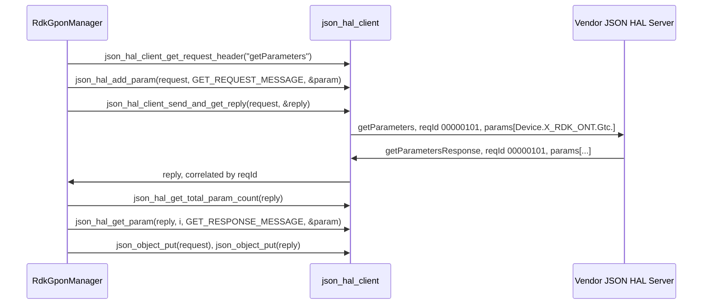
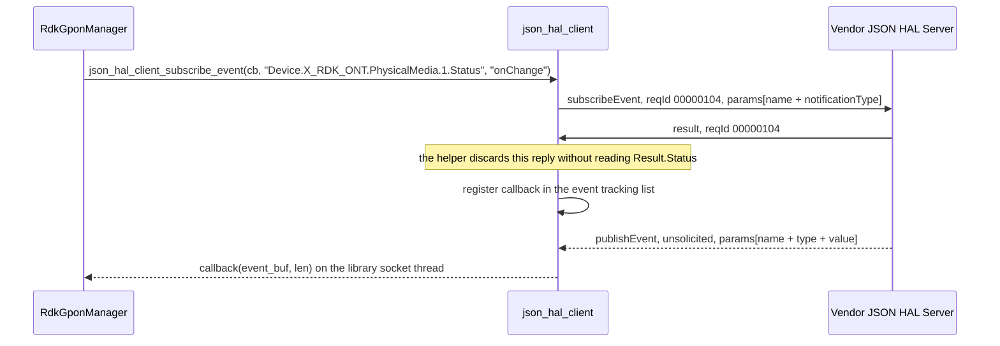

# GPON HAL Detailed API Reference

## Purpose

This document is the per-parameter reference for the `GPON` `JSON` HAL. It stands to the schema
files as inline `Doxygen` documentation stands to a C header: for every parameter the contract
declares, it gives the `TR-181` path, the wire datatype, the value constraint, the access the server
enforces and the meaning the schema states. The interface overview — architecture, initialization,
threading, memory and blocking behaviour — is in [halSpec.md](halSpec.md).

**Each schema file has one consumer, `RdkGponManager`, and a build loads exactly one file:**
`hal_schema/gpon_hal_schema.json` declares 90 parameter definitions and is loaded by the default
`RdkGponManager` build. `hal_schema/gpon_wan_unify_hal_schema.json` declares 95 and is loaded by an
`RdkGponManager` build that defines `WAN_MANAGER_UNIFICATION_ENABLED`. `Deployment contract` gives the
selection. The second file is a strict superset of the first: it adds five `PhysicalMedia`
definitions and lists them in `getParameterSupportedList`, three of them also in
`setParameterSupportedList`, and every definition the two files share has the same `name`, `type`,
`value` constraint and `description`. The tables below therefore present the union and mark the
five variant-only definitions.

Transport behaviour is that of `json-hal-library` at commit
`86a0a300b976f8e3295064af8fb3fd1c793c9e64`. `GPON` is not available on the `HUB6` or `XER10`
reference platforms, so no behaviour described here has been observed on a device.

## Transport and Protocol

### The envelope

Every message in either direction carries the same four **required** fields. Three of them are bound
to a definition; `reqId` is declared inline on the schema root.

| Field | Bound to | Form | Set by |
| --- | --- | --- | --- |
| `module` | `moduleName` | JSON `string`; const `gponhal` | Read by the client out of the deployed schema file |
| `version` | `schemaVersion` | JSON `string`; const `0.0.1` | Read by the client out of the deployed schema file |
| `action` | `action` | JSON `string`; one of the eleven members below | The caller, per request |
| `reqId` | declared inline | JSON `string`; pattern `^[0-9]+$` | The client library, one per request header |

The `schemaVersion` description states "DO NOT modify the value of the version string. HAL operation
cannot be performed without correct supported version.", so no sender alters `0.0.1`.

**Members beyond the four are accepted:** Neither schema root declares `additionalProperties: false`,
so a message carrying members beyond the four required fields and the payload its action binds still
validates. A caller sends only what an action binds, and a server does not rely on an unknown member
being rejected.

**The `reqId` field is a decimal counter zero-padded to at least eight digits:** The client formats it with
`sprintf(id, "%8.8d", req_id)`, which pads a shorter value to eight characters and does not truncate
a longer one. The counter starts at `100` and increments once per request header, so the first
request of a fresh process carries `"00000101"`, and the identifier grows to nine and then ten
digits as the counter passes `99999999`. Every form satisfies `^[0-9]+$`, which sets no length. The
counter is a `static int`, so the increment past `INT_MAX` is signed overflow and no identifier may
be asserted beyond that point. The client parses a received `reqId` with `strtol(..., 16)` — base
16 — on both the send and the match side; the two agree for every decimal value the counter emits,
but a `reqId` containing a hexadecimal letter would be parsed differently from how it was written. A
server echoes the identifier it was sent, unchanged.

**A server accepts at most 63 bytes of `reqId`:** The schema sets no `maxLength`, but the pinned
server copies the value into 64-byte arrays without terminating an over-long one (see
`Fixed-size buffers on the receive path` under `Contract Defects`). A server therefore validates
presence, pattern and a length of at most 63 bytes before dispatching on the value. The shipped
client never exceeds the bound; a caller building its own envelope must not either.

### Message boundaries

**Nothing frames a message on this transport, so every message must fit in one read:** There is no
length prefix and no delimiter. Each side reads into a 16384-byte buffer (`MAX_BUFFER_SIZE`). The
server reads once per readable descriptor and does not accumulate. The client accumulates only while
a read fills the buffer, so it judges completeness by **buffer occupancy** rather than by `JSON`
structure:

- **A read that leaves room in the buffer is parsed as though the document were complete:** A message
  below 16384 bytes is therefore not guaranteed to arrive whole: a split delivery hands truncated
  `JSON` to the parser at any size.
- **A reply is not parsed while every read in its sequence comes back full**, and in that state the
  client's idle callback, which ages pending requests, is suppressed, so the synchronous wait in
  `Error Handling` runs with no timer beneath it.
- **The accumulator is `NUL`-delimited**, because each append copies `MAX_BUFFER_SIZE` bytes at an
  offset computed with `strlen()`.

A bulk read is therefore scoped so that the `getParametersResponse` it provokes stays well inside the
buffer — the practical constraint on the object-prefix reads in `Object Index` — and a failed
exchange is treated as a possible truncation rather than as a refusal.

### The action vocabulary

`definitions.action` declares exactly eleven members, identical in both files and in this order:
`getSchema`, `getParameters`, `getParametersResponse`, `setParameters`, `subscribeEvent`,
`getActiveSubscriptions`, `getActiveSubscriptionsResponse`, `getSchemaResponse`, `publishEvent`,
`deleteObject`, `result`.

**There is no `setParametersResponse`:** A write is acknowledged by the generic `result` action
carrying `Result.Status`, which also answers `subscribeEvent`. `deleteObject` has no reply, because no
valid `deleteObject` message exists (`D1` under `Contract Defects`).

**The transport names seven of the eleven actions as macros:** `json_rpc_common.h` defines
`JSON_RPC_ACTION_GET_PARAM`, `JSON_RPC_ACTION_GET_PARAM_RESPONSE`, `JSON_RPC_ACTION_RESULT`,
`JSON_RPC_ACTION_GET_SCHEMA`, `JSON_RPC_ACTION_GET_SCHEMA_RESPONSE`,
`JSON_RPC_SUBSCRIBE_EVENT_ACTION_NAME` and `JSON_RPC_PUBLISH_EVENT_ACTION_NAME`. A caller passes
`setParameters`, `getActiveSubscriptions`, `getActiveSubscriptionsResponse` and `deleteObject` as
literal strings; `RdkGponManager` defines its own `SET_PARAMETER_METHOD` for the first.

### Payload binding per action

Eight of the eleven actions bind a payload through one of the schema root's eight `allOf` branches.
Three bind nothing.

| Action | Direction | Payload the schema binds | Required members of each `params` entry |
| --- | --- | --- | --- |
| `getSchema` | client to server | none — bare envelope | not applicable |
| `getParameters` | client to server | `params`; JSON `array`; minItems 1; uniqueItems | `name` |
| `getParametersResponse` | server to client | `params`; JSON `array`; minItems 1; uniqueItems | `name`, `type`, `value` |
| `setParameters` | client to server | `params`; JSON `array`; minItems 1; uniqueItems | `name`, `type`, `value` |
| `subscribeEvent` | client to server | `params`; JSON `array`; minItems 1; uniqueItems | `name`, `notificationType` |
| `getActiveSubscriptions` | client to server | none — bare envelope | not applicable |
| `getActiveSubscriptionsResponse` | server to client | none — bare envelope | not applicable |
| `getSchemaResponse` | server to client | `SchemaInfo`; JSON `object`; `FilePath` required | not applicable |
| `publishEvent` | server to client | `params`; JSON `array`; minItems 1; uniqueItems | `name`, `type`, `value` |
| `deleteObject` | client to server | `params`; JSON `array`; minItems 1; uniqueItems; **uninstantiable**; see `D1` | `name`, but no value satisfies it |
| `result` | server to client | `Result`; JSON `object`; `Status` required | not applicable |

**An unbound action may still carry an empty `params` array:** A bare four-field envelope validates
for `getSchema`, `getActiveSubscriptions` and `getActiveSubscriptionsResponse`. The transport's header
helper, `json_hal_client_get_request_header()`, attaches an empty `params` array unless
`strncmp(action_name, "getSchema", strlen("getSchema"))` matches. That is a prefix test, so
`getSchema` and `getSchemaResponse` get no array and the other nine — `getActiveSubscriptions` and
`getActiveSubscriptionsResponse` included — do. Both forms validate for the unbound actions, because
the root permits the extra member and no `allOf` branch constrains `params` there. Three consequences
follow:

- Before sending an action that binds `params`, the caller appends to the helper's array: `minItems`
  is 1, so an empty array fails validation.
- A server accepts an empty `params` array on the three unbound actions, because the standard client
  sends one for two of them.
- `json_hal_add_param()` returns `RETURN_ERR` on a `getSchema` or `getSchemaResponse` message, which
  has no array to append to, so a payload for either is attached with plain `json-c` calls — for
  `getSchemaResponse`, the `SchemaInfo` object the schema binds.

**The `Result` and `SchemaInfo` objects forbid extension:** `Result` carries a single `Status` property and
`SchemaInfo` a single `FilePath` property, each with `additionalProperties: false`. `FilePath` must
match `^(.+)/([^/]+)$`, so a bare filename does not validate.

### Parameter entry shapes

A `params` entry names a `TR-181` path in `name` and, depending on the action, carries `type`,
`value` and `notificationType`. Which entries are legal for a given action is decided by an `anyOf`
over a named list rather than by a free-form shape, and that is what makes the surface closed:

| Action | Entry must satisfy | Which means |
| --- | --- | --- |
| `getParameters`, `getParametersResponse` | `getParameterSupportedList` or `getParameterOptionalList` | Any of the 90 parameters or any of the 26 objects — 95 parameters in the variant. `getParametersResponse` additionally requires `type` and `value`, which excludes `ontPhysicalMediaAlarmObj`; see `The validation boundary` |
| `setParameters` | `setParameterSupportedList` or `setParameterOptionalList` | The 8 writable parameters, or 11 in the variant. The optional list is empty; see `D1` |
| `subscribeEvent`, `publishEvent` | `subscribeEventSupportedList` | Exactly the 18 subscribable parameters, identical in both variants |
| `deleteObject` | an empty `anyOf` | Nothing. The action is uninstantiable |

A leaf parameter definition declares `name`, `type` and `value`, and 89 of the 90 forbid any other
member with `additionalProperties: false`. Two of the 18 subscribable definitions also declare
`notificationType` (`Event Model`). An object definition declares `name` alone. Only the two read
actions reach object definitions and `ontTR69url`, so only their verdicts depend on which of the
four definition kinds below an entry's `name` resolves to.

### The validation boundary

**Nothing on this interface validates an inbound message against the deployed schema:**

- **The client validates nothing:** `json_hal_client_init()` calls `json_hal_load_config()` and wires
  the socket callbacks without initialising a validator, so neither a reply nor an inbound
  `publishEvent` is checked before it reaches the caller.
- **The server validates only its own replies, and only when built with
  `JSON_SCHEMA_VALIDATION_ENABLED`:** `json_hal_server_init()` then calls the validator wrapper's
  `json_validator_init`, and a reply the server generated that fails validation is replaced with a
  `Not Supported` result. An inbound request is never validated on either side.
- **The schema root accepts unknown members**, so even a validator does not reject an unexpected
  top-level member.

Schema conformance is therefore a testing and implementation obligation, not a runtime guarantee. A
caller that needs a malformed reply or event rejected validates it itself, against the schema file
its configuration names; `Event Model` states where that obligation is sharpest.

**The verdict on a `params` entry depends on which of four kinds of definition its `name` resolves
to:**

| Definition kind | How many | What the definition declares | What it therefore rejects |
| --- | --- | --- | --- |
| Closed leaf | 89 of 90 parameters; 94 of 95 in the variant | `name`, `type` and `value`, with `additionalProperties: false` | An unknown member; a `null` `value`; a `type` label other than its `const`; a value outside its constraint |
| Open leaf | `ontTR69url` alone, in both files | the same three, **without** `additionalProperties: false` | A `null` `value` and a wrong `type` label — but **not** an unknown member |
| Open object | 25 of the 26 object definitions | `name` alone, no `additionalProperties: false` | Nothing beyond its `name` pattern. `type`, `value` and any further member are unconstrained, so a `null` value and a nonsense `type` label both validate |
| Closed object | `ontPhysicalMediaAlarmObj` alone | `name` alone **with** `additionalProperties: false` | Every member except `name` — so this prefix cannot appear in any action whose entry requires `type` and `value` |

The action's own `required` list applies on top of all four: an entry in a `getParametersResponse`,
`setParameters` or `publishEvent` message carries `name`, `type` and `value` even where its
definition constrains none of them, which is why `ontPhysicalMediaAlarmObj` cannot appear in a
response (`D5`).

**Boundary conditions:** Each row gives the schema verdict per definition kind and what reaches the
peer at runtime, where nothing validates.

| Condition | Schema verdict, by referenced definition | Runtime behaviour |
| --- | --- | --- |
| `value` present but `null` | **Invalid** against either leaf kind: every leaf constrains `value` by type. **Valid** against an open object, where `value` is an unconstrained extra member | Delivered unchecked. A caller inspects the `value` node before extracting it with `json_hal_get_param()` |
| A required member of a `params` entry missing | **Invalid for all four kinds:** `required` is set by the action: `name` for `getParameters` and `deleteObject`, `name`/`type`/`value` for `setParameters`, `getParametersResponse` and `publishEvent`, `name`/`notificationType` for `subscribeEvent` | Delivered unchecked. For a missing `value` the extraction helper's outcome depends on the datatype; see `Missing value: five datatypes fail silently` |
| `params` present but an empty array | Invalid for every action that binds `params`, because each branch sets `minItems: 1`. Valid for the three actions with no binding, which is what the client's header helper produces for two of them | Delivered unchecked |
| Two `params` entries naming the **same parameter** with different content | **Valid:** `uniqueItems` compares whole entry objects, not the `name` member, so it rejects only JSON-equal entries: the same members with equal values, in any member order. A two-entry `setParameters` on `Device.X_RDK_ONT.PhysicalMedia.1.RxPower.SignalLevelLowerThreshold` carrying `-30` and `-25` validates, as does a `subscribeEvent` naming `Device.X_RDK_ONT.PhysicalMedia.1.Status` twice with `interval` and `onChange` | Delivered unchecked. `result` carries one `Status` for the whole message, so a caller cannot learn which value was applied |
| An unknown member alongside the four required envelope fields | Valid. The root declares no `additionalProperties: false` | Ignored: the pinned transport reads no member it does not expect |
| An unknown member inside a `params` entry | **Invalid** against a closed leaf and against `ontPhysicalMediaAlarmObj`. **Valid** against `ontTR69url` and against all 25 open object definitions — see `D4` and `D5` | Delivered unchecked |
| A `type` label that disagrees with the parameter's declared datatype | **Invalid** against either leaf kind, which binds `type` to a `const`. **Valid** against any object definition, which declares no `type` at all | Delivered unchecked; nothing cross-checks the label against the value |
| A value outside the parameter's constraint | **Invalid** against a leaf, **except** for `PonMode` and `Connector`, whose enumeration reference is inert (`D2`). **Unconstrained** against an open object — see `D5` | Delivered unchecked; the caller checks it, as `Numeric fidelity` below sets out |
| `reqId` sent as a `JSON` number rather than a string | Invalid. The envelope requires `string` | Correlation still works on the client, which stringifies before parsing. The pinned server's publish helper sends this form; see `Event Model` |

**A parameter named twice in one message has no defined effect:** The schema gives `params` no
order and acknowledges a write with a single `Result.Status`, so which of two values was applied
cannot be learned from the reply. A caller de-duplicates `params` by `name` before dispatch and does not use
entry order to express intent; a vendor that accepts duplicates documents which value it applies; and
a test does not read schema validity of a multi-entry message as evidence of what the server did.

### Missing value: five datatypes fail silently

**When a `params` entry omits `value`, `json_hal_get_param()` reports failure for three datatypes and
success for five, and the successes are indistinguishable from a genuine zero:** The helper zeroes
the caller's `hal_param_t` on entry and then dispatches on the entry's `type` label:

| Entry's `type` label | Result when `value` is absent |
| --- | --- |
| `string`, `hexBinary`, `base64` | `RETURN_ERR` |
| `boolean`, `int`, `unsignedInt`, `long`, `unsignedLong` | `RETURN_OK`, with `param->value` left as the empty string while `param->type` is set as though a value had been read |
| any label matching none of the eight | `RETURN_OK`, with the struct still fully zeroed |
| any label, under the publish action | `RETURN_OK`, with the struct fully zeroed: `PUBLISHEVENT_RESPONSE_MESSAGE` shares the `default` arm, which reads nothing |

The return code is therefore not a sufficient check. Before extracting, confirm with
`json_object_object_get_ex()` that the entry carries `name`, `type` and `value`. After extracting,
test `param->type` for membership of `eParamType`: `0` is outside the enumeration, whose first member
is `PARAM_BOOLEAN = 1`, and is the only signal for the last two rows. And test `param->value` for
emptiness where a value was required, because an empty string converted with `atoi()`, `atol()` or
`atoll()` yields `0`, so a missing counter reads as a counter of zero.

`RdkGponManager` does not use this helper on its event path: its internal `get_event_param` splits the
`publishEvent` message itself and returns failure when `name` or `value` is absent.

**Date, time and encoding:** No parameter in either schema uses a date, time or duration datatype:
the datatypes in use are `string`, `int`, `unsignedInt`, `unsignedLong` and, in the variant only,
`boolean`, and the variant's `LastChange` is an elapsed-seconds `unsignedInt`.
`Device.X_RDK_ONT.Ploam.SerialNumber` travels as an even-length hexadecimal string, constrained to
`^([a-fA-F0-9]{2})+$` with a maximum length of 128. The transport also recognises `long`,
`hexBinary` and `base64`, which no `GPON` parameter declares, so a message using one of those labels
names a datatype this contract does not.

**Numeric fidelity:** 46 of the 90 base parameters and 47 of the 95 variant parameters are
`unsignedInt` or `unsignedLong`, and both datatypes cross the transport through signed accessors
with no range check:

- **Extraction:** `json_hal_get_param()` selects an arm by prefix-comparing the `type` label, so the
  arm follows the label rather than the `JSON` value. The `unsignedInt` arm reads with
  `json_object_get_int()` and formats with `"%d"`; the `unsignedLong` arm uses
  `json_object_get_int64()` and `"%ld"`. The resulting string is a signed rendering while
  `param->type` announces `PARAM_UNSIGNED_INTEGER` or `PARAM_UNSIGNED_LONG`, so a caller re-validates
  it as a decimal rather than trusting it as an unsigned value.
- **Construction:** `json_hal_add_param()` converts with `atoi()` for `int`, `atol()` for `long` and
  `atoll()` **for both unsigned datatypes**, then wraps `unsignedInt` with `json_object_new_int()`, a
  32-bit signed container, and `unsignedLong` with `json_object_new_int64()`. None of the three
  conversions reports an error: a non-numeric string yields `0` and conversion stops silently at the
  first non-digit.
- **Out-of-range numbers:** A `JSON` number outside the accessor's `int32_t` or `int64_t` range is
  converted by the linked `json-c`. The two revisions `json-hal-library` names — `json-c (0.11)` as
  the declared minimum and `json-c-0.15-20200726` as the revision its native build uses — clamp it to
  the nearest bound, and another build may differ, so no test asserts a particular converted value.

The caller therefore checks every numeric entry, in both directions: that the string is **wholly**
numeric, non-negative where the datatype is unsigned, inside the range the `Parameter Reference` row
states, a member of the enumeration where the row names one, and within the **width** of the
declared datatype. The schema does not check width: `Device.X_RDK_ONT.Ploam.OnuId`, bounded at 1022,
is the only definition in either file with a `maximum`, so 45 of the 46 unsigned definitions (46 of
47 in the variant) have no upper bound, and `PhysicalMedia.{i}.Bias.CurrentBias` also declares no
`minimum`, so a negative value validates against it.

**Unsupported actions:** `deleteObject` cannot be instantiated (`D1`), so a caller
does not send it and a vendor need not implement it beyond parsing the enumeration member. The
vocabulary has no `addObject` and no unsubscribe action: the vendor creates and destroys object
instances, and a subscription cannot be withdrawn through this interface. The pinned server library
answers an action that has no registered callback with a `Not Supported` result (`Error Handling`).

## Deployment contract

**Two steps decide which contract a deployment speaks:** the compile flag selects a configuration
file, and the configuration file selects the schema.

| Step | Default build | `WAN_MANAGER_UNIFICATION_ENABLED` defined |
| --- | --- | --- |
| 1 — flag selects the configuration file | `/etc/rdk/conf/gpon_manager_conf.json` | `/etc/rdk/conf/gpon_manager_wan_unify_conf.json` |
| 2 — configuration names the schema | `/etc/rdk/schemas/gpon_hal_schema.json` | `/etc/rdk/schemas/gpon_wan_unify_hal_schema.json` |
| 2 — configuration names the port | `40100` | `40100` |
| Parameter definitions in that schema | 90 | 95 |
| Writable parameters | 8 | 11 |

`RdkGponManager` sets `GPON_MANAGER_CONF_FILE` under `#if defined(WAN_MANAGER_UNIFICATION_ENABLED)` and
passes that path to `json_hal_client_init()`. Each of `config/gpon_manager_conf.json` and
`config/gpon_manager_wan_unify_conf.json` carries exactly two keys, `hal_schema_path` and
`server_port`. Four consequences matter to an integrator:

- The port is `40100` in both builds, so a vendor server cannot tell from its port which variant it
  serves.
- The schema file is a **runtime** dependency of the client, which reads `moduleName` and
  `schemaVersion` from it, so it must exist and be readable at the configured path.
- Both variants declare `moduleName` `gponhal` and `schemaVersion` `0.0.1`, so a variant mismatch
  between the two sides is not detectable from the envelope; it surfaces as an unrecognised
  parameter name.
- The socket is loopback-only: the client connects to `127.0.0.1` and takes only the port from the
  configuration, so both processes run on the same device. A vendor server listens on
  `127.0.0.1:40100`, with a listen backlog of 32.

## Object Index

**An object definition is a `name` and nothing else**, and it makes a *prefix* readable: a
`getParameters` entry naming an object path asks for that object's parameters in one round trip. The
26 object definitions are identical in both files.

**A prefix is addressable only if it satisfies an object definition's `name` constraint:** Five
definitions — the singleton segments `Gtc.`, `Omci.`, `Ploam.` and `TR69.`, plus
`Ploam.RegistrationTimers.` — declare an exact `const`, so a request naming `Device.X_RDK_ONT.Gtc.`
validates as it stands. The other 21, covering the instanced segments `PhysicalMedia`, `Gem` and
`Veip` and their sub-objects, declare a `pattern` requiring an instance number, so the bare
`Device.X_RDK_ONT.PhysicalMedia.` does **not** validate while `Device.X_RDK_ONT.PhysicalMedia.1.`
does. `RdkGponManager` issues the bare form for all seven segments, so three of its seven bulk reads do
not conform (`D6`). In the table, `{i}` stands for the `\d+` the pattern requires,
not for a literal a caller may send.

| Object path | Definition key | `name` form | Addressable as a read prefix |
| --- | --- | --- | --- |
| `Device.X_RDK_ONT.Gem.{i}.` | `ontGemObj` | `pattern` `^Device\.X_RDK_ONT\.Gem\.\d+\.$` | per instance only |
| `Device.X_RDK_ONT.Gem.{i}.EthernetFlow.` | `ontGemEthernetFlowObj` | `pattern` `^Device\.X_RDK_ONT\.Gem\.\d+\.EthernetFlow\.$` | per instance only |
| `Device.X_RDK_ONT.Gem.{i}.EthernetFlow.Egress.` | `ontGemEthernetFlowEgressObj` | `pattern` `^Device\.X_RDK_ONT\.Gem\.\d+\.EthernetFlow\.Egress\.$` | per instance only |
| `Device.X_RDK_ONT.Gem.{i}.EthernetFlow.Egress.C-VLAN.` | `ontGemEthernetFlowEgressCVlanObj` | `pattern` `^Device\.X_RDK_ONT\.Gem\.\d+\.EthernetFlow\.Egress\.C-VLAN\.$` | per instance only |
| `Device.X_RDK_ONT.Gem.{i}.EthernetFlow.Egress.S-VLAN.` | `ontGemEthernetFlowEgressSVlanObj` | `pattern` `^Device\.X_RDK_ONT\.Gem\.\d+\.EthernetFlow\.Egress\.S-VLAN\.$` | per instance only |
| `Device.X_RDK_ONT.Gem.{i}.EthernetFlow.Ingress.` | `ontGemEthernetFlowIngressObj` | `pattern` `^Device\.X_RDK_ONT\.Gem\.\d+\.EthernetFlow\.Ingress\.$` | per instance only |
| `Device.X_RDK_ONT.Gem.{i}.EthernetFlow.Ingress.C-VLAN.` | `ontGemEthernetFlowIngressCVlanObj` | `pattern` `^Device\.X_RDK_ONT\.Gem\.\d+\.EthernetFlow\.Ingress\.C-VLAN\.$` | per instance only |
| `Device.X_RDK_ONT.Gem.{i}.EthernetFlow.Ingress.S-VLAN.` | `ontGemEthernetFlowIngressSVlanObj` | `pattern` `^Device\.X_RDK_ONT\.Gem\.\d+\.EthernetFlow\.Ingress\.S-VLAN\.$` | per instance only |
| `Device.X_RDK_ONT.Gtc.` | `ontGtcObj` | `const` | yes |
| `Device.X_RDK_ONT.Omci.` | `ontOmciObj` | `const` | yes |
| `Device.X_RDK_ONT.PhysicalMedia.{i}.` | `ontPhysicalMediaObjName` | `pattern` `^Device\.X_RDK_ONT\.PhysicalMedia\.\d+\.$` | per instance only |
| `Device.X_RDK_ONT.PhysicalMedia.{i}.Alarm.` | `ontPhysicalMediaAlarmObj` | `pattern` `^Device\.X_RDK_ONT\.PhysicalMedia\.\d+\.Alarm\.$` | per instance only |
| `Device.X_RDK_ONT.PhysicalMedia.{i}.Bias.` | `ontPhysicalMediaBiasObj` | `pattern` `^Device\.X_RDK_ONT\.PhysicalMedia\.\d+\.Bias\.$` | per instance only |
| `Device.X_RDK_ONT.PhysicalMedia.{i}.PerformanceThreshold.` | `ontPhysicalMediaPerformanceThresholdObj` | `pattern` `^Device\.X_RDK_ONT\.PhysicalMedia\.\d+\.PerformanceThreshold\.$` | per instance only |
| `Device.X_RDK_ONT.PhysicalMedia.{i}.RxPower.` | `ontPhysicalMediaRxPowerObj` | `pattern` `^Device\.X_RDK_ONT\.PhysicalMedia\.\d+\.RxPower\.$` | per instance only |
| `Device.X_RDK_ONT.PhysicalMedia.{i}.Temperature.` | `ontPhysicalMediaTemperatureObj` | `pattern` `^Device\.X_RDK_ONT\.PhysicalMedia\.\d+\.Temperature\.$` | per instance only |
| `Device.X_RDK_ONT.PhysicalMedia.{i}.TxPower.` | `ontPhysicalMediaTxPowerObj` | `pattern` `^Device\.X_RDK_ONT\.PhysicalMedia\.\d+\.TxPower\.$` | per instance only |
| `Device.X_RDK_ONT.PhysicalMedia.{i}.Voltage.` | `ontPhysicalMediaVoltageObj` | `pattern` `^Device\.X_RDK_ONT\.PhysicalMedia\.\d+\.Voltage\.$` | per instance only |
| `Device.X_RDK_ONT.Ploam.` | `ontPloamObj` | `const` | yes |
| `Device.X_RDK_ONT.Ploam.RegistrationTimers.` | `ontPloamRegistrationTimersObj` | `const` | yes |
| `Device.X_RDK_ONT.TR69.` | `ontTR69Obj` | `const` | yes |
| `Device.X_RDK_ONT.Veip.{i}.` | `ontVeipObj` | `pattern` `^Device\.X_RDK_ONT\.Veip\.\d+\.$` | per instance only |
| `Device.X_RDK_ONT.Veip.{i}.EthernetFlow.Egress.` | `ontVeipEthernetFlowEgressObj` | `pattern` `^Device\.X_RDK_ONT\.Veip\.\d+\.EthernetFlow\.Egress.$` | per instance only (`D3`) |
| `Device.X_RDK_ONT.Veip.{i}.EthernetFlow.Egress.Q-VLAN.` | `ontVeipEthernetFlowEgressQVlanObj` | `pattern` `^Device\.X_RDK_ONT\.Veip\.\d+\.EthernetFlow\.Egress\.Q-VLAN\.$` | per instance only |
| `Device.X_RDK_ONT.Veip.{i}.EthernetFlow.Ingress.` | `ontVeipEthernetFlowIngressObj` | `pattern` `^Device\.X_RDK_ONT\.Veip\.\d+\.EthernetFlow\.Ingress.$` | per instance only (`D3`) |
| `Device.X_RDK_ONT.Veip.{i}.EthernetFlow.Ingress.Q-VLAN.` | `ontVeipEthernetFlowIngressQVlanObj` | `pattern` `^Device\.X_RDK_ONT\.Veip\.\d+\.EthernetFlow\.Ingress\.Q-VLAN\.$` | per instance only |

## Parameter Reference

The 95 rows are the 90 definitions of `hal_schema/gpon_hal_schema.json` plus the 5 the `wan_unify`
variant adds, sectioned by `TR-181` segment under `Device.X_RDK_ONT`. Each table has four columns:

- `TR-181 Parameter · definition key` — the path the definition's `name` binds, with `{i}` for each
  `\d+` instance index, then ` · ` and the schema definition key; *wan_unify only* marks the five
  definitions only the variant declares.
- `Type and Constraint` — the `type.const` the entry's `type` member carries, then the `value`
  constraint: `JSON` and the value's JSON type with its `minimum`, `maximum`, `maxLength`, `pattern`
  or `one of` keywords, or `values from` and the enumeration it references. A cell that gives only the
  JSON type has no further constraint.
- `Access` — `Read-Write` for a definition in `setParameterSupportedList` or
  `setParameterOptionalList`, `Read-Only` otherwise; `optional` marks a definition only the optional
  list for that direction references, and `subscribable` a member of `subscribeEventSupportedList`.
  In every definition of both files this agrees with the `(Access = …)` marker.
- `Description` — the schema's `description` without its `(Access = …)` marker.

Eight parameters are writable in the default schema and eleven in the variant, and 18 are
subscribable. `getParameterOptionalList` lists 16 parameters and 8 objects; the three `TR69`
definitions are also in `getParameterSupportedList`, so the 14 parameters and 7 objects of the `Gem`
Ethernet-flow subtree are the ones reachable only through the optional list.

### PhysicalMedia

`Device.X_RDK_ONT.PhysicalMedia.{i}.` — 41 parameter definitions, of which **5 exist only in the
`wan_unify` variant**. The optical transceiver and its alarms. This is the largest segment and the
only one the `wan_unify` variant extends. The 14 `Alarm.` parameters use uppercase acronym suffixes
— `RDI`, `PEE`, `LOS`, `LOF`, `DACT`, `DIS`, `MIS`, `MEM`, `SUF`, `SD`, `SF`, `LCDG`, `TF` and
`ROGUE` — matched exactly by their `name` patterns, so a title-cased spelling does not validate. Six
sub-objects group the optical measurements: `RxPower.`, `TxPower.`, `Voltage.`, `Bias.`,
`Temperature.` and `PerformanceThreshold.`, each listed in `Object Index`.

| TR-181 Parameter · definition key | Type and Constraint | Access | Description |
| --- | --- | --- | --- |
| `Device.X_RDK_ONT.PhysicalMedia.{i}.Alarm.DACT` · `ontPhysicalMediaAlarmDact` | `string`; values from `alarmEnumList` | Read-Only, subscribable | Deactivate ONU-ID |
| `Device.X_RDK_ONT.PhysicalMedia.{i}.Alarm.DIS` · `ontPhysicalMediaAlarmDis` | `string`; values from `alarmEnumList` | Read-Only, subscribable | Disabled ONU |
| `Device.X_RDK_ONT.PhysicalMedia.{i}.Alarm.LCDG` · `ontPhysicalMediaAlarmLcdg` | `string`; values from `alarmEnumList` | Read-Only, subscribable | Loss of GEM channel delineation, When GEM fragment delineation is lost according to clause 8.3.2 state machine |
| `Device.X_RDK_ONT.PhysicalMedia.{i}.Alarm.LOF` · `ontPhysicalMediaAlarmLof` | `string`; values from `alarmEnumList` | Read-Only, subscribable | Loss of frame |
| `Device.X_RDK_ONT.PhysicalMedia.{i}.Alarm.LOS` · `ontPhysicalMediaAlarmLos` | `string`; values from `alarmEnumList` | Read-Only, subscribable | Loss of signal |
| `Device.X_RDK_ONT.PhysicalMedia.{i}.Alarm.MEM` · `ontPhysicalMediaAlarmMem` | `string`; values from `alarmEnumList` | Read-Only, subscribable | Message error message, when ONU receives an unknown message |
| `Device.X_RDK_ONT.PhysicalMedia.{i}.Alarm.MIS` · `ontPhysicalMediaAlarmMis` | `string`; values from `alarmEnumList` | Read-Only, subscribable | Link mismatching |
| `Device.X_RDK_ONT.PhysicalMedia.{i}.Alarm.PEE` · `ontPhysicalMediaAlarmPee` | `string`; values from `alarmEnumList` | Read-Only, subscribable | Physical Equipment error |
| `Device.X_RDK_ONT.PhysicalMedia.{i}.Alarm.RDI` · `ontPhysicalMediaAlarmRdi` | `string`; values from `alarmEnumList` | Read-Only, subscribable | Remote defect indication |
| `Device.X_RDK_ONT.PhysicalMedia.{i}.Alarm.ROGUE` · `ontPhysicalMediaAlarmRogue` | `string`; values from `alarmEnumList` | Read-Only, subscribable | ROGUE ONU, The ONU transmitter is declared as ROGUE ONU |
| `Device.X_RDK_ONT.PhysicalMedia.{i}.Alarm.SD` · `ontPhysicalMediaAlarmSd` | `string`; values from `alarmEnumList` | Read-Only, subscribable | Signal failed, when BER value is beyond to the one configured at the ONU |
| `Device.X_RDK_ONT.PhysicalMedia.{i}.Alarm.SF` · `ontPhysicalMediaAlarmSf` | `string`; values from `alarmEnumList` | Read-Only, subscribable | Signal failed, when BER value is beyond to the one configured at the ONU |
| `Device.X_RDK_ONT.PhysicalMedia.{i}.Alarm.SUF` · `ontPhysicalMediaAlarmSuf` | `string`; values from `alarmEnumList` | Read-Only, subscribable | Start up failure, when the ranging of the ONU has failed |
| `Device.X_RDK_ONT.PhysicalMedia.{i}.Alarm.TF` · `ontPhysicalMediaAlarmTf` | `string`; values from `alarmEnumList` | Read-Only, subscribable | Transmitter failure, The ONU transmitter is declared in failure when there is no nominal backfacet photocurrent or when the drive currents go beyond the maximum specification |
| `Device.X_RDK_ONT.PhysicalMedia.{i}.Alias` · `ontPhysicalMediaAlias` · *wan_unify only* | `string`; JSON `string`; maxLength 64 | Read-Write | The alias, it shows a non-volatile unique key used to reference this instance. Alias provides a mechanism for a Controller to label this instance for future reference. |
| `Device.X_RDK_ONT.PhysicalMedia.{i}.Bias.CurrentBias` · `ontPhysicalMediaCurrentBias` | `unsignedInt`; JSON `integer` | Read-Only | The bias current measured at the optical module |
| `Device.X_RDK_ONT.PhysicalMedia.{i}.Cage` · `ontPhysicalMediaCage` | `string`; JSON `string`; one of `BoB`, `SFP` | Read-Only | Specifies the hardware layout for the optical device, bosa on board or external SFP |
| `Device.X_RDK_ONT.PhysicalMedia.{i}.Connector` · `ontPhysicalMediaConnector` | `string`; JSON `string`; no value constraint in effect (`D2`) | Read-Only | The kind of optical connector used in the optical module |
| `Device.X_RDK_ONT.PhysicalMedia.{i}.Enable` · `ontPhysicalMediaEnable` · *wan_unify only* | `boolean`; JSON `boolean` | Read-Write | The Enable, indicates whether the interface is enabled or disbled. |
| `Device.X_RDK_ONT.PhysicalMedia.{i}.LastChange` · `ontPhysicalMediaLastChange` · *wan_unify only* | `unsignedInt`; JSON `integer`; minimum 0 | Read-Only | The last change, it shows the accumulated time in seconds since the DSL line entered its current operational state. |
| `Device.X_RDK_ONT.PhysicalMedia.{i}.LowerLayers` · `ontPhysicalMediaLowerLayers` · *wan_unify only* | `string`; JSON `string`; maxLength 1024 | Read-Write | The lower layers, it shows comma-separated list (maximum list length 1024) of strings. |
| `Device.X_RDK_ONT.PhysicalMedia.{i}.ModuleFirmwareVersion` · `ontPhysicalMediaModuleFirmwareVersion` | `string`; JSON `string`; maxLength 256 | Read-Only | Informs about the firmware version of the optical module |
| `Device.X_RDK_ONT.PhysicalMedia.{i}.ModuleName` · `ontPhysicalMediaModuleName` | `string`; JSON `string`; maxLength 256 | Read-Only | Informs about the module name of the optical module |
| `Device.X_RDK_ONT.PhysicalMedia.{i}.ModuleVendor` · `ontPhysicalMediaModuleVendor` | `string`; JSON `string`; maxLength 256 | Read-Only | Informs about the vendor of the optical media |
| `Device.X_RDK_ONT.PhysicalMedia.{i}.ModuleVersion` · `ontPhysicalMediaModuleVersion` | `string`; JSON `string`; maxLength 256 | Read-Only | Informs about the hardware version of the optical module |
| `Device.X_RDK_ONT.PhysicalMedia.{i}.NominalBitRateDownstream` · `ontPhysicalMediaNominalBitRateDownstream` | `unsignedInt`; JSON `integer`; minimum 0 | Read-Only | The nominal bit rate for PonMode configured Downstream |
| `Device.X_RDK_ONT.PhysicalMedia.{i}.NominalBitRateUpstream` · `ontPhysicalMediaNominalBitRateUpstream` | `unsignedInt`; JSON `integer`; minimum 0 | Read-Only | The nominal bit rate for PonMode configured upstream |
| `Device.X_RDK_ONT.PhysicalMedia.{i}.PerformanceThreshold.SignalDegrade` · `ontPhysicalMediaPerformanceThresholdSignalDegrade` | `unsignedInt`; JSON `integer`; minimum 0 | Read-Only | This attribute specifies the downstream bit error rate (BER) threshold to detect the SD alarm, The SD threshold must be lower than the SF threshold |
| `Device.X_RDK_ONT.PhysicalMedia.{i}.PerformanceThreshold.SignalFail` · `ontPhysicalMediaPerformanceThresholdSignalFail` | `unsignedInt`; JSON `integer`; minimum 0 | Read-Only | This attribute specifies the downstream bit error rate (BER) threshold to detect the SF alarm |
| `Device.X_RDK_ONT.PhysicalMedia.{i}.PonMode` · `ontPhysicalMediaPonMode` | `string`; JSON `string`; no value constraint in effect (`D2`) | Read-Only | The passive optical network mode supported by the optical module and ONT |
| `Device.X_RDK_ONT.PhysicalMedia.{i}.RedundancyState` · `ontPhysicalMediaRedundancyState` | `string`; values from `redundancyStateEnumList` | Read-Only | The redundancy state, it shows the current redundancy state of the optical interface at physical level |
| `Device.X_RDK_ONT.PhysicalMedia.{i}.RxPower.SignalLevel` · `ontPhysicalMediaRxPowerSignalLevel` | `int`; JSON `integer` | Read-Only | The optical level received at the optical module |
| `Device.X_RDK_ONT.PhysicalMedia.{i}.RxPower.SignalLevelLowerThreshold` · `ontPhysicalMediaRxPowerSignalLevelLowerThreshold` | `int`; JSON `integer` | Read-Write | The optical level threshold configured to generate a Low signal level alarm |
| `Device.X_RDK_ONT.PhysicalMedia.{i}.RxPower.SignalLevelUpperThreshold` · `ontPhysicalMediaRxPowerSignalLevelUpperThreshold` | `int`; JSON `integer` | Read-Write | The optical level threshold configured to generate an signal overload alarm |
| `Device.X_RDK_ONT.PhysicalMedia.{i}.Status` · `ontPhysicalMediaStatus` | `string`; values from `statusEnumList` | Read-Only, subscribable | It shows the current operational status of the optical interface at physical level |
| `Device.X_RDK_ONT.PhysicalMedia.{i}.Temperature.CurrentTemp` · `ontPhysicalMediaTemperatureCurrentTemp` | `int`; JSON `integer` | Read-Only | The current temperature measured at the optical module |
| `Device.X_RDK_ONT.PhysicalMedia.{i}.TxPower.SignalLevel` · `ontPhysicalMediaTxPowerSignalLevel` | `int`; JSON `integer` | Read-Only | The optical level received at the optical module |
| `Device.X_RDK_ONT.PhysicalMedia.{i}.TxPower.SignalLevelLowerThreshold` · `ontPhysicalMediaTxPowerSignalLevelLowerThreshold` | `int`; JSON `integer` | Read-Write | The optical level threshold configured to generate a Low signal level alarm |
| `Device.X_RDK_ONT.PhysicalMedia.{i}.TxPower.SignalLevelUpperThreshold` · `ontPhysicalMediaTxPowerSignalLevelUpperThreshold` | `int`; JSON `integer` | Read-Write | The optical level threshold configured to generate an signal overload alarm |
| `Device.X_RDK_ONT.PhysicalMedia.{i}.Upstream` · `ontPhysicalMediaUpstream` · *wan_unify only* | `boolean`; JSON `boolean` | Read-Only | The Upstream, indicates whether the interface points towards the Internet (true) or towards End Devices (false). |
| `Device.X_RDK_ONT.PhysicalMedia.{i}.Voltage.VoltageLevel` · `ontPhysicalMediaVoltageLevel` | `int`; JSON `integer` | Read-Only | The voltage measured the optical module |

### Gem

`Device.X_RDK_ONT.Gem.{i}.` — 18 parameter definitions. `GEM` port state and its Ethernet flow,
including `C-VLAN` and `S-VLAN` tag handling. Fourteen of the eighteen are reachable only through
`getParameterOptionalList`, so a vendor may answer `Not Supported` for any of them without violating
the contract; the four reachable through `getParameterSupportedList` are `PortId`, `ReceivedFrames`,
`TransmittedFrames` and `TrafficType`. Nothing in this segment is writable or subscribable.

| TR-181 Parameter · definition key | Type and Constraint | Access | Description |
| --- | --- | --- | --- |
| `Device.X_RDK_ONT.Gem.{i}.EthernetFlow.Egress.C-VLAN.Dei` · `ontGemEthernetFlowEgressCVlanDei` | `unsignedInt`; JSON `integer`; minimum 0 | Read-Only, optional | Drop Eligible Indicator |
| `Device.X_RDK_ONT.Gem.{i}.EthernetFlow.Egress.C-VLAN.Pcp` · `ontGemEthernetFlowEgressCVlanPcp` | `unsignedInt`; JSON `integer`; minimum 0 | Read-Only, optional | Priority Code Point |
| `Device.X_RDK_ONT.Gem.{i}.EthernetFlow.Egress.C-VLAN.Vid` · `ontGemEthernetFlowEgressCVlanVid` | `unsignedInt`; JSON `integer`; minimum 0 | Read-Only, optional | VLAN ID |
| `Device.X_RDK_ONT.Gem.{i}.EthernetFlow.Egress.S-VLAN.Dei` · `ontGemEthernetFlowEgressSVlanDei` | `unsignedInt`; JSON `integer`; minimum 0 | Read-Only, optional | Drop Eligible Indicator |
| `Device.X_RDK_ONT.Gem.{i}.EthernetFlow.Egress.S-VLAN.Pcp` · `ontGemEthernetFlowEgressSVlanPcp` | `unsignedInt`; JSON `integer`; minimum 0 | Read-Only, optional | Priority Code Point |
| `Device.X_RDK_ONT.Gem.{i}.EthernetFlow.Egress.S-VLAN.Vid` · `ontGemEthernetFlowEgressSVlanVid` | `unsignedInt`; JSON `integer`; minimum 0 | Read-Only, optional | VLAN ID |
| `Device.X_RDK_ONT.Gem.{i}.EthernetFlow.Egress.Tagged` · `ontGemEthernetFlowEgressTagged` | `string`; JSON `string`; one of `Single`, `Double` | Read-Only, optional | Informs the network traffic configuration |
| `Device.X_RDK_ONT.Gem.{i}.EthernetFlow.Ingress.C-VLAN.Dei` · `ontGemEthernetFlowIngressCVlanDei` | `unsignedInt`; JSON `integer`; minimum 0 | Read-Only, optional | Drop Eligible Indicator |
| `Device.X_RDK_ONT.Gem.{i}.EthernetFlow.Ingress.C-VLAN.Pcp` · `ontGemEthernetFlowIngressCVlanPcp` | `unsignedInt`; JSON `integer`; minimum 0 | Read-Only, optional | Priority Code Point |
| `Device.X_RDK_ONT.Gem.{i}.EthernetFlow.Ingress.C-VLAN.Vid` · `ontGemEthernetFlowIngressCVlanVid` | `unsignedInt`; JSON `integer`; minimum 0 | Read-Only, optional | VLAN ID |
| `Device.X_RDK_ONT.Gem.{i}.EthernetFlow.Ingress.S-VLAN.Dei` · `ontGemEthernetFlowIngressSVlanDei` | `unsignedInt`; JSON `integer`; minimum 0 | Read-Only, optional | Drop Eligible Indicator |
| `Device.X_RDK_ONT.Gem.{i}.EthernetFlow.Ingress.S-VLAN.Pcp` · `ontGemEthernetFlowIngressSVlanPcp` | `unsignedInt`; JSON `integer`; minimum 0 | Read-Only, optional | Priority Code Point |
| `Device.X_RDK_ONT.Gem.{i}.EthernetFlow.Ingress.S-VLAN.Vid` · `ontGemEthernetFlowIngressSVlanVid` | `unsignedInt`; JSON `integer`; minimum 0 | Read-Only, optional | VLAN ID |
| `Device.X_RDK_ONT.Gem.{i}.EthernetFlow.Ingress.Tagged` · `ontGemEthernetFlowIngressTagged` | `string`; JSON `string`; one of `Single`, `Double` | Read-Only, optional | Informs the network traffic configuration |
| `Device.X_RDK_ONT.Gem.{i}.PortId` · `ontGemPortId` | `unsignedInt`; JSON `integer`; minimum 0 | Read-Only | The identification of the Gem port |
| `Device.X_RDK_ONT.Gem.{i}.ReceivedFrames` · `ontGemReceivedFrames` | `unsignedLong`; JSON `integer`; minimum 0 | Read-Only | Number of frames received by this port |
| `Device.X_RDK_ONT.Gem.{i}.TrafficType` · `ontGemTrafficType` | `string`; JSON `string`; one of `Unidirectional`, `Bidirectional` | Read-Only | The kind of traffic associated to this port based on what kind of GEM port |
| `Device.X_RDK_ONT.Gem.{i}.TransmittedFrames` · `ontGemTransmittedFrames` | `unsignedLong`; JSON `integer`; minimum 0 | Read-Only | Number of frames transmitted by this port |

### Veip

`Device.X_RDK_ONT.Veip.{i}.` — 13 parameter definitions. The Virtual Ethernet Interface Point and
its `Q-VLAN` Ethernet flows. Four of the eight writable parameters in the default schema live here.
Four definitions in this segment carry a malformed `name` pattern; see `D3`.

| TR-181 Parameter · definition key | Type and Constraint | Access | Description |
| --- | --- | --- | --- |
| `Device.X_RDK_ONT.Veip.{i}.AdministrativeState` · `ontVeipAdministrativeState` | `string`; values from `lockEnumList` | Read-Only, subscribable | Informs the current administrative state of Veip interface from OMCI domain |
| `Device.X_RDK_ONT.Veip.{i}.EthernetFlow.Egress.Q-VLAN.Dei` · `ontVeipEthernetFlowEgressQVlanDei` | `unsignedInt`; JSON `integer`; minimum 0 | Read-Only | Drop Eligible Indicator |
| `Device.X_RDK_ONT.Veip.{i}.EthernetFlow.Egress.Q-VLAN.Pcp` · `ontVeipEthernetFlowEgressQVlanPcp` | `unsignedInt`; JSON `integer`; minimum 0 | Read-Only | Priority Code Poin |
| `Device.X_RDK_ONT.Veip.{i}.EthernetFlow.Egress.Q-VLAN.Vid` · `ontVeipEthernetFlowEgressQVlanVid` | `unsignedInt`; JSON `integer`; minimum 0 | Read-Write | VLAN ID |
| `Device.X_RDK_ONT.Veip.{i}.EthernetFlow.Egress.Tagged` · `ontVeipEthernetFlowEgressTagged` | `string`; JSON `string`; one of `Untagged`, `Single`, `Double` | Read-Write | Informs the network traffic configuration (`D3`) |
| `Device.X_RDK_ONT.Veip.{i}.EthernetFlow.Ingress.Q-VLAN.Dei` · `ontVeipEthernetFlowIngressQVlanDei` | `unsignedInt`; JSON `integer`; minimum 0 | Read-Only | Drop Eligible Indicator |
| `Device.X_RDK_ONT.Veip.{i}.EthernetFlow.Ingress.Q-VLAN.Pcp` · `ontVeipEthernetFlowIngressQVlanPcp` | `unsignedInt`; JSON `integer`; minimum 0 | Read-Only | Priority Code Point |
| `Device.X_RDK_ONT.Veip.{i}.EthernetFlow.Ingress.Q-VLAN.Vid` · `ontVeipEthernetFlowIngressQVlanVid` | `unsignedInt`; JSON `integer`; minimum 0 | Read-Write | VLAN ID |
| `Device.X_RDK_ONT.Veip.{i}.EthernetFlow.Ingress.Tagged` · `ontVeipEthernetFlowIngressTagged` | `string`; JSON `string`; one of `Untagged`, `Single`, `Double` | Read-Write | Informs the network traffic configuration (`D3`) |
| `Device.X_RDK_ONT.Veip.{i}.InterDomainName` · `ontVeipInterDomainName` | `string`; JSON `string`; maxLength 25 | Read-Only | This attribute is a character string that provides an optional way to identify the VEIP to a non-OMCI management domain, and expose the default provider brigde configuration. |
| `Device.X_RDK_ONT.Veip.{i}.InterfaceName` · `ontVeipInterfaceName` | `string`; JSON `string`; maxLength 256 | Read-Only | Informs about interface name used on top of the Veip to terminate vlan traffic |
| `Device.X_RDK_ONT.Veip.{i}.MeId` · `ontVeipMeId` | `unsignedInt`; JSON `integer`; minimum 0 | Read-Only | Identifier of the VEIP ME |
| `Device.X_RDK_ONT.Veip.{i}.OperationalState` · `ontVeipOperationalState` | `string`; JSON `string`; one of `Up`, `Down`, `Unknown`, `Dormant`, `NotPresent`, `LowerLayerDown`, `Error` | Read-Only, subscribable | Informs the current operational state of Veip interface from OMCI domain |

### Ploam

`Device.X_RDK_ONT.Ploam.` — 10 parameter definitions. `PLOAM` registration state, the two
registration timers and the `PLOAM` message counters. `Ploam` is a singleton, so every path here is
an exact `const` with no instance number, and the whole segment is addressable as a read prefix.

| TR-181 Parameter · definition key | Type and Constraint | Access | Description |
| --- | --- | --- | --- |
| `Device.X_RDK_ONT.Ploam.ActivationCounter` · `ontPloamActivationCounter` | `unsignedInt`; JSON `integer`; minimum 0 | Read-Only | The number of times the ONU pass through O5 between reboots |
| `Device.X_RDK_ONT.Ploam.MicErrors` · `ontPloamMicErrors` | `unsignedInt`; JSON `integer`; minimum 0 | Read-Only | The number of packets with MIC errors |
| `Device.X_RDK_ONT.Ploam.OnuId` · `ontPloamOnuId` | `unsignedInt`; JSON `integer`; minimum 0; maximum 1022 | Read-Only | The vendor id of the ONU the same as the 4 most significant bytes of the ONU serial number |
| `Device.X_RDK_ONT.Ploam.RegistrationState` · `ontPloamRegistrationState` | `string`; JSON `string`; one of `O1`, `O2`, `O3`, `O4`, `O5`, `O6`, `O7`, `O8`, `O9` | Read-Only, subscribable | The registration state of ONT |
| `Device.X_RDK_ONT.Ploam.RegistrationTimers.TO1` · `ontPloamRegistrationTimersTO1` | `unsignedInt`; JSON `integer`; minimum 0 | Read-Only | Ranging timer |
| `Device.X_RDK_ONT.Ploam.RegistrationTimers.TO2` · `ontPloamRegistrationTimersTO2` | `unsignedInt`; JSON `integer`; minimum 0 | Read-Only | Loss of downstream synchronization |
| `Device.X_RDK_ONT.Ploam.RxMessageCount` · `ontPloamRxMessageCount` | `unsignedInt`; JSON `integer`; minimum 0 | Read-Only | The number of PLOAM messages received |
| `Device.X_RDK_ONT.Ploam.SerialNumber` · `ontPloamSerialNumber` | `string`; JSON `string`; maxLength 128; pattern `^([a-fA-F0-9]{2})+$` | Read-Only | ONU serial number as defined in the TC layer |
| `Device.X_RDK_ONT.Ploam.TxMessageCount` · `ontPloamTxMessageCount` | `unsignedInt`; JSON `integer`; minimum 0 | Read-Only | The number of PLOAM messages transmitted |
| `Device.X_RDK_ONT.Ploam.VendorId` · `ontPloamVendorId` | `string`; JSON `string` | Read-Only | The vendor id of the ONU the same as the 4 most significant bytes |

### Gtc

`Device.X_RDK_ONT.Gtc.` — 8 parameter definitions. `GTC` framing counters and the `FEC` corrected
and uncorrected counts. A singleton, addressable as a read prefix. Nothing in this segment is
writable or subscribable.

| TR-181 Parameter · definition key | Type and Constraint | Access | Description |
| --- | --- | --- | --- |
| `Device.X_RDK_ONT.Gtc.CorrectedFecBytes` · `ontGtcCorrectedFecBytes` | `unsignedLong`; JSON `integer`; minimum 0 | Read-Only | Count of FEC codewords that contained errors but were corrected by the FEC function. Reference: ITU-T G.988, Clause 9.2.9 and 9.2.22 |
| `Device.X_RDK_ONT.Gtc.CorrectedFecCodeWords` · `ontGtcCorrectedFecCodeWords` | `unsignedLong`; JSON `integer`; minimum 0 | Read-Only | Count of FEC codewords that contained errors but were corrected by the FEC function. Reference: ITU-T G.988, Clause 9.2.9 and 9.2.2 |
| `Device.X_RDK_ONT.Gtc.FrameHecErrors` · `ontGtcFrameHecErrors` | `unsignedLong`; JSON `integer`; minimum 0 | Read-Only | The number of instances of an XGEM frame HEC error. (Reference: 'Count of XGEM frame header HEC errors' in Table C.14.1 of ITU-T G.9807,ITU-T G.988, Clause 9.2.15 and 9.2.23) |
| `Device.X_RDK_ONT.Gtc.FramesLost` · `ontGtcFramesLost` | `unsignedLong`; JSON `integer`; minimum 0 | Read-Only | The number of 4 byte words lost because of an XGEM frame HEC error. Reference: ITU-T G.988, Clause 9.2.15 and 9.2.23 |
| `Device.X_RDK_ONT.Gtc.HecErrorCount` · `ontGtcHecErrorCount` | `unsignedLong`; JSON `integer`; minimum 0 | Read-Only | The number of FEC words included into a physical burst payload. (Reference: 'FS HEC error count' defined in Table C.14.1 of ITU-T G.9807) |
| `Device.X_RDK_ONT.Gtc.PSBdHecErrors` · `ontGtcPSBdHecErrors` | `unsignedLong`; JSON `integer`; minimum 0 | Read-Only | This attribute counts HEC errors in any of the fields of the downstream physical sync block (Reference: 'PSBd HEC error count' defined in Table C.14.1 of ITU-T G.9807,ITU-T G.988, Clause 9.2.15 and 9.2.23) |
| `Device.X_RDK_ONT.Gtc.TotalFecCodeWords` · `ontGtcGtcTotalFecCodeWords` | `unsignedLong`; JSON `integer`; minimum 0 | Read-Only | Count of total received code words. Reference: ITU-T G.988, Clause 9.2.9 and 9.2.22 |
| `Device.X_RDK_ONT.Gtc.UnCorrectedFecCodeWords` · `ontGtcUnCorrectedFecCodeWords` | `unsignedLong`; JSON `integer`; minimum 0 | Read-Only | Count of FEC codewords that contained errors and could not be corrected by the FEC function. Reference: ITU-T G.988, Clause 9.2.9 and 9.2.22 |

### Omci

`Device.X_RDK_ONT.Omci.` — 3 parameter definitions. `OMCI` message counts and the `MIC` error count.
A singleton, addressable as a read prefix. Nothing in this segment is writable or subscribable.

| TR-181 Parameter · definition key | Type and Constraint | Access | Description |
| --- | --- | --- | --- |
| `Device.X_RDK_ONT.Omci.MicErrors` · `ontOmciMicErrors` | `unsignedInt`; JSON `integer`; minimum 0 | Read-Only | Count of MIC errors |
| `Device.X_RDK_ONT.Omci.RxBaseLineMessageCountValid` · `ontOmciRxBaseLineMessageCountValid` | `unsignedInt`; JSON `integer`; minimum 0 | Read-Only | Count of OMCI messages |
| `Device.X_RDK_ONT.Omci.RxExtendedMessageCountValid` · `ontOmciRxExtendedMessageCountValid` | `unsignedInt`; JSON `integer`; minimum 0 | Read-Only | Count of OMCI messages |

### TR69

`Device.X_RDK_ONT.TR69.` — 2 parameter definitions. The `ACS` address and the tag carried from the
`OMCI` domain into the `TR-069` domain. A singleton, addressable as a read prefix, and listed in both
`getParameterSupportedList` and `getParameterOptionalList`. `url` is the one parameter definition in
either file that omits `additionalProperties: false`; see `D4`.

| TR-181 Parameter · definition key | Type and Constraint | Access | Description |
| --- | --- | --- | --- |
| `Device.X_RDK_ONT.TR69.AssociatedTag` · `ontTR69AssociatedTag` | `unsignedInt`; JSON `integer`; minimum 0 | Read-Only | Tag to transfer information from OMCI domain to TR69 domain |
| `Device.X_RDK_ONT.TR69.url` · `ontTR69url` | `string`; JSON `string` | Read-Only | ACS URI to be used by DNS client to resolve to an IP address |

## Enumeration Appendix

Nine named enumerations are declared, identically in both files. They are this interface's
analogue of a C HAL's `enum` declarations, and a caller treats each as closed: a value outside the
list does not validate, except for the two lists a defect leaves unenforced. A `Members` cell carries
only the members, so a member list may be read from the table directly.

| Enumeration | Members | Default | Where it is used |
| --- | --- | --- | --- |
| `action` | `getSchema`, `getParameters`, `getParametersResponse`, `setParameters`, `subscribeEvent`, `getActiveSubscriptions`, `getActiveSubscriptionsResponse`, `getSchemaResponse`, `publishEvent`, `deleteObject`, `result` | none | The callable surface. Every member is listed in `Payload binding per action` |
| `resultStatusEnumList` | `Success`, `Failed`, `Invalid Argument`, `Not Supported` | `Success` | The four values `Result.Status` may take. `Error Handling` gives the caller action for each |
| `notificationType` | `interval`, `onChange` | `onChange` | The two notification types a `subscribeEvent` entry may request. The transport admits two more; see `Event Model` |
| `statusEnumList` | `Up`, `Down`, `Unknown`, `Dormant`, `NotPresent`, `LowerLayerDown`, `Error` | none | Referenced once, by `PhysicalMedia.{i}.Status`. `Veip.{i}.OperationalState` declares the same seven members inline instead of referencing this list |
| `alarmEnumList` | `Active`, `Inactive` | none | Referenced by all 14 `PhysicalMedia.{i}.Alarm.` parameters — the most-used enumeration in the contract |
| `lockEnumList` | `Lock`, `Unlock` | none | Referenced once, by `Veip.{i}.AdministrativeState` |
| `redundancyStateEnumList` | `Active`, `Standby` | none | Referenced once, by `PhysicalMedia.{i}.RedundancyState` |
| `ponModeEnumList` | `GPON`, `XG-PON`, `NG-PON2`, `XGS-PON` | none | **Declared but never enforced:** Its single reference is nested under a non-keyword `value` key; see `D2` |
| `physicalConnectorEnumList` | `LC`, `ST`, `FC`, `SC`, `MT-RJ` | none | **Declared but never enforced:** Its single reference is nested under a non-keyword `value` key; see `D2` |

**Eight further parameters carry an inline `enum` rather than a reference to a named
enumeration:** They are the same in both files, shown in six rows because two pairs of parameters
share a value set:

| Parameter | Members | Note |
| --- | --- | --- |
| `Ploam.RegistrationState` | `O1`, `O2`, `O3`, `O4`, `O5`, `O6`, `O7`, `O8`, `O9` | Subscribable; the `PLOAM` state machine states |
| `PhysicalMedia.{i}.Cage` | `BoB`, `SFP` | Bosa-on-board or external `SFP` |
| `Gem.{i}.TrafficType` | `Unidirectional`, `Bidirectional` | — |
| `Gem.{i}.EthernetFlow.Ingress.Tagged`, `Gem.{i}.EthernetFlow.Egress.Tagged` | `Single`, `Double` | Two parameters, one value set. Note that the `Gem` pair omits `Untagged`, which the `Veip` pair admits |
| `Veip.{i}.EthernetFlow.Ingress.Tagged`, `Veip.{i}.EthernetFlow.Egress.Tagged` | `Untagged`, `Single`, `Double` | Two parameters, one value set |
| `Veip.{i}.OperationalState` | `Up`, `Down`, `Unknown`, `Dormant`, `NotPresent`, `LowerLayerDown`, `Error` | Subscribable. The same seven members `statusEnumList` declares, restated inline rather than referenced |

**25 of the 90 parameters are constrained to a closed value set:** the 17 whose `value` references a
named enumeration effectively — 14 alarms plus `PhysicalMedia.{i}.Status`,
`PhysicalMedia.{i}.RedundancyState` and `Veip.{i}.AdministrativeState` — and the 8 above.
`PhysicalMedia.{i}.PonMode` and `PhysicalMedia.{i}.Connector`, whose reference is inert, are not
among them (`D2`).

## Worked Message Examples

**Five workflows cover ten of the eleven actions:** `deleteObject` cannot be instantiated, so no
delete message is published. Every `JSON` block below validates against the schema the text beside
it names. The `reqId` values follow the form the client emits (`Transport and Protocol`); a real
exchange carries whatever value the counter has reached.

The two diagrams are fenced `mermaid` blocks: they render on GitHub, and the generated `Doxygen` site
shows their source text.



### Read parameters

`getParameters` names one or more paths and the server answers `getParametersResponse` with the same
paths, each carrying its datatype label and its value. The request below reads the `Gtc` singleton
prefix, which is addressable because `ontGtcObj` declares an exact `const`.

**Request:** `RdkGponManager` to the vendor JSON HAL server, valid against both
`hal_schema/gpon_hal_schema.json` and `hal_schema/gpon_wan_unify_hal_schema.json`.

```json
{
  "module": "gponhal",
  "version": "0.0.1",
  "action": "getParameters",
  "reqId": "00000101",
  "params": [
    { "name": "Device.X_RDK_ONT.Gtc." }
  ]
}
```

The response repeats each leaf under that prefix with its `type` and `value`. Two of the eight `Gtc`
parameters are shown; a real reply carries every parameter the vendor implements under the prefix.

**Response:** the vendor JSON HAL server to `RdkGponManager`.

```json
{
  "module": "gponhal",
  "version": "0.0.1",
  "action": "getParametersResponse",
  "reqId": "00000101",
  "params": [
    { "name": "Device.X_RDK_ONT.Gtc.CorrectedFecBytes", "type": "unsignedLong", "value": 41233 },
    { "name": "Device.X_RDK_ONT.Gtc.FramesLost", "type": "unsignedLong", "value": 0 }
  ]
}
```

**Reading the entries:** A caller walks the array with `json_hal_get_total_param_count()` and
`json_hal_get_param()`, which **copies** each entry into a caller-supplied `hal_param_t` —
`char name[256]; char value[2048]; eParamType type;` — so the extracted value is caller-owned
storage that outlives `json_object_put()`; only a pointer taken directly with
`json_object_get_string()` has the reply's lifetime. The copy leaves 255 usable bytes for a `name`
and 2047 for a `value`. Neither schema bounds a name, because instance numbers are an unbounded
`\d+`, and `PhysicalMedia.{i}.PonMode`, `PhysicalMedia.{i}.Connector`, `Ploam.VendorId` and
`TR69.url` do not bound their value, so a caller measures each inbound `name` and `value` and rejects
an over-long one before the copy (`Fixed-size buffers on the receive path` under `Contract Defects`).
The helper's datatype dispatch is a prefix comparison —
`strncmp(param_type, "string", strlen("string"))` and its siblings — so a caller that needs the
label checked exactly compares it against the parameter's `type` `const` from `Parameter Reference`.

`hal_schema/example_getParameters_msg.json` names the bare prefix `Device.X_RDK_ONT.PhysicalMedia.`,
which `ontPhysicalMediaObjName` does not match because it requires an instance number. The conforming
form addresses the instance.

**Request:** `RdkGponManager` to the vendor JSON HAL server, the corrected form of the shipped
fixture, valid against both files.

```json
{
  "module": "gponhal",
  "version": "0.0.1",
  "action": "getParameters",
  "reqId": "00000101",
  "params": [
    { "name": "Device.X_RDK_ONT.PhysicalMedia.1." }
  ]
}
```

### Write parameters

A write carries `name`, `type` and `value`, and the entry must satisfy `setParameterSupportedList`.
It is acknowledged by `result`, **not** by a response action named after the request. The example
writes an optical alarm threshold, one of the eight writable parameters in the default schema.

**Request:** `RdkGponManager` to the vendor JSON HAL server, valid against both files.

```json
{
  "module": "gponhal",
  "version": "0.0.1",
  "action": "setParameters",
  "reqId": "00000102",
  "params": [
    {
      "name": "Device.X_RDK_ONT.PhysicalMedia.1.RxPower.SignalLevelLowerThreshold",
      "type": "int",
      "value": -2700
    }
  ]
}
```

The acknowledgement is the canonical `result` message, which also answers `subscribeEvent`.

**Response:** the vendor JSON HAL server to `RdkGponManager`.

```json
{
  "module": "gponhal",
  "version": "0.0.1",
  "action": "result",
  "reqId": "00000102",
  "Result": {
    "Status": "Success"
  }
}
```

**A `wan_unify`-only write:** `hal_schema/example_setParameters_msg.json` writes
`Device.X_RDK_ONT.PhysicalMedia.1.Enable` with `type` `boolean`. That parameter exists only in
`hal_schema/gpon_wan_unify_hal_schema.json`, so the fixture is invalid against the default schema and
valid, unchanged, against the variant; a build that has not defined `WAN_MANAGER_UNIFICATION_ENABLED`
does not send it. The block reproduces the file byte for byte, including its irregular whitespace;
the file itself has no final newline.

**Request:** `RdkGponManager` to the vendor JSON HAL server, `wan_unify` variant only, the shipped
bytes.

```json
{
  "module": "gponhal",
  "version": "0.0.1",  
  "action": "setParameters",
  "reqId" : "100001",
  "params":
  [
     {"name":"Device.X_RDK_ONT.PhysicalMedia.1.Enable", "type":"boolean", "value": true}
  ]
}
```

### Retrieve the server's schema location

`getSchema` travels without a `params` array, and the server answers `getSchemaResponse` carrying
`SchemaInfo.FilePath`. The exchange is not a prerequisite for anything else — the client takes its
schema path from its configuration — and its value is that it reveals a mismatch between the two
sides.

**Request:** `RdkGponManager` to the vendor JSON HAL server, valid against both files.

```json
{
  "module": "gponhal",
  "version": "0.0.1",
  "action": "getSchema",
  "reqId": "00000103"
}
```

`hal_schema/example_getSchemaResponse_msg.json` is schema-valid but returns
`/etc/rdk/hal_schemas/xtm_hal_schema.json` — the `xTM` schema, under a directory no `GPON`
configuration names. A default-build server returns the path `config/gpon_manager_conf.json` names,
as below; a `wan_unify` server returns `/etc/rdk/schemas/gpon_wan_unify_hal_schema.json`.

**Response:** the vendor JSON HAL server to `RdkGponManager`, the corrected form of the shipped fixture.

```json
{
  "module": "gponhal",
  "version": "0.0.1",
  "action": "getSchemaResponse",
  "reqId": "00000103",
  "SchemaInfo": {
    "FilePath": "/etc/rdk/schemas/gpon_hal_schema.json"
  }
}
```

### Subscribe, then receive

A subscription entry carries `name` and `notificationType` and no value, and the entry must satisfy
`subscribeEventSupportedList`. The server acknowledges with `result`, in the form shown under
`Write parameters`, and thereafter sends `publishEvent` unsolicited.



**Request:** `RdkGponManager` to the vendor JSON HAL server, valid against both files.

```json
{
  "module": "gponhal",
  "version": "0.0.1",
  "action": "subscribeEvent",
  "reqId": "00000104",
  "params": [
    {
      "name": "Device.X_RDK_ONT.PhysicalMedia.1.Status",
      "notificationType": "onChange"
    }
  ]
}
```

The event the vendor then publishes carries all three of `name`, `type` and `value`, so a receiver
does not have to look the datatype up.

**Event:** the vendor JSON HAL server to `RdkGponManager`, unsolicited.

```json
{
  "module": "gponhal",
  "version": "0.0.1",
  "action": "publishEvent",
  "reqId": "00000105",
  "params": [
    {
      "name": "Device.X_RDK_ONT.PhysicalMedia.1.Status",
      "type": "string",
      "value": "Up"
    }
  ]
}
```

A vendor constructs this message itself: the pinned server's `json_hal_server_publish_event()` emits
a form that fails validation (`Event Model`).

### Enumerate subscriptions

`getActiveSubscriptions` and `getActiveSubscriptionsResponse` bind no payload. Both validate as the
four-field envelope, and both also validate with the empty `params` array the client's header helper
attaches.

**Request:** `RdkGponManager` to the vendor JSON HAL server.

```json
{
  "module": "gponhal",
  "version": "0.0.1",
  "action": "getActiveSubscriptions",
  "reqId": "00000106"
}
```

**Response:** the vendor JSON HAL server to `RdkGponManager`.

```json
{
  "module": "gponhal",
  "version": "0.0.1",
  "action": "getActiveSubscriptionsResponse",
  "reqId": "00000106"
}
```

Because neither schema binds a payload to `getActiveSubscriptionsResponse`, the response carries no
list of subscriptions, and the transport provides no client helper for either action. A caller
therefore tracks its own subscriptions, and a vendor and a caller that need this exchange to carry
content agree on its representation outside this contract.

### Delete an object instance

`deleteObject` is a member of the `action` enumeration, but its payload definition is
`{"anyOf": [], "required": ["name"]}` in both files, so no valid message exists and none is
published. A caller does not send it (`D1`).

### The shipped fixtures

Eight `hal_schema/example_*_msg.json` files ship beside the schemas. They are left unmodified, so
every correction exists only in this document.

| File | Schema verdict | Disposition here |
| --- | --- | --- |
| `example_getParameters_msg.json` | **Invalid against both:** Names the bare prefix `Device.X_RDK_ONT.PhysicalMedia.`, which `ontPhysicalMediaObjName` does not match | Corrected form published under `Read parameters` |
| `example_setParameters_msg.json` | Invalid against the base schema, **valid unchanged against the variant**, which adds `PhysicalMedia.{i}.Enable` | Published as its shipped bytes under `Write parameters`, with the variant named |
| `example_getSchemaResponse_msg.json` | Valid against both, and **semantically wrong:** returns `/etc/rdk/hal_schemas/xtm_hal_schema.json` | Corrected path published under `Retrieve the server's schema location` |
| `example_getSchema_msg.json` | Valid against both | Needs no correction; the worked exchange above is authored |
| `example_getParametersResponse_msg.json` | Valid against both | Needs no correction; the worked exchange above is authored |
| `example_subscribeEvent_msg.json` | Valid against both | Needs no correction; the worked exchange above is authored |
| `example_publishEvent_msg.json` | Valid against both | Needs no correction; the worked exchange above is authored |
| `example_result_msg.json` | Valid against both | Needs no correction; the worked exchange above is authored |

Only `example_setParameters_msg.json` is quoted byte for byte; every other block, the two
corrections included, is authored against the schema. The fixtures use six-digit `reqId` values such
as `"100001"`, shorter than anything the client emits, so **a test asserts only that a reply's
`reqId` equals its request's**, never a width. No fixture exists for `getActiveSubscriptions`,
`getActiveSubscriptionsResponse` or `deleteObject`.

## Contract Defects

Seven defects sit in the shipped schemas. None is repaired, because the schemas are the contract and
downstream tests may already depend on their bytes. Each entry states what the defect costs a caller and
what a test does about it. Most of them are invisible to message-level validation — an unreachable
branch, an inert subschema or a missing `additionalProperties` shows only under a meta-schema check
or a definition-level walk — so a vendor can pass every test built from the shipped fixtures and
still be affected by all seven.

### D1 — deleteObject and setParameterOptionalList carry an empty anyOf

`definitions.deleteObject` is `{"anyOf": [], "required": ["name"]}` and
`definitions.setParameterOptionalList` is `{"description": "...", "anyOf": []}`, in **both** files.
An empty `anyOf` matches no instance, because at least one branch must match and there are none.

So **the `deleteObject` action is uninstantiable:** no schema-valid delete message exists, and object deletion
is unavailable through this interface whatever a vendor implements. And because `setParameters`
binds its entries to `setParameterSupportedList` **or** `setParameterOptionalList`, and the second
branch never matches, the writable surface is exactly `setParameterSupportedList` — 8 parameters in
the default schema and 11 in the variant.

The same two arrays are why both files fail `Draft7Validator.check_schema`, which requires a schema
array to be non-empty; each file fails in exactly these two places.

**What a test should do:** Exclude `deleteObject` from action coverage rather than record it as a
failing case, treat `setParameterOptionalList` as empty by construction, and in a meta-schema check
expect exactly two failures per file and fail on a third.

### D2 — two enumerations are declared and never enforced

`definitions.ontPhysicalMediaPonMode` and `definitions.ontPhysicalMediaConnector` constrain their
`value` as `{"type": "string", "value": {"$ref": "#/definitions/ponModeEnumList"}}` and the
`physicalConnectorEnumList` equivalent. **The `value` member is not a `JSON` Schema keyword**, so the nested
subschema is inert and the effective constraint on both parameters is `type: string`: a
`getParametersResponse` carrying `Device.X_RDK_ONT.PhysicalMedia.1.PonMode` with the value
`NOT-A-MODE` validates against both schemas, and so does an arbitrary string for `Connector`. These
are the only references to `ponModeEnumList` and `physicalConnectorEnumList`, so the intended sets —
`GPON`, `XG-PON`, `NG-PON2`, `XGS-PON` and `LC`, `ST`, `FC`, `SC`, `MT-RJ` — constrain nothing
anywhere in the contract.

**What a test should do:** Treat the two enumerations as documentation of intent. A test that a
server rejects an out-of-list `PonMode` asserts behaviour the schema does not require; a test that a
server reports only listed values is a vendor conformance test and is labelled as one.

### D3 — four name patterns contain an unescaped .

`ontVeipEthernetFlowIngressObj` and `ontVeipEthernetFlowEgressObj` declare
`^Device\.X_RDK_ONT\.Veip\.\d+\.EthernetFlow\.Ingress.$` and the `Egress` equivalent;
`ontVeipEthernetFlowIngressTagged` and `ontVeipEthernetFlowEgressTagged` declare
`^Device\.X_RDK_ONT\.Veip\.\d+\.EthernetFlow\.Ingress.Tagged$` and the `Egress` equivalent. The `.`
after `Ingress` or `Egress` is not escaped, so it matches any character:
`Device.X_RDK_ONT.Veip.1.EthernetFlow.EgressX` matches the object pattern and
`Device.X_RDK_ONT.Veip.1.EthernetFlow.EgressZTagged` matches the parameter pattern.

**This defect has a write consequence:** Both `Tagged` definitions are members of
`setParameterSupportedList`, so a `setParameters` message naming `EgressZTagged` validates, and a
strictly validating vendor server would accept a write to a path that does not exist in the data
model. The intended paths — `Device.X_RDK_ONT.Veip.{i}.EthernetFlow.Ingress.` and `.Egress.` for the
objects, `...Ingress.Tagged` and `...Egress.Tagged` for the parameters — are what the
`Parameter Reference` and `Object Index` rows show.

**What a test should do:** Send only the intended paths. A negative test that a near-miss path is
rejected fails against a conforming implementation for these four definitions, so it is excluded
with a reference to this defect rather than recorded as a vendor fault.

### D4 — one parameter definition omits additionalProperties: false

`definitions.ontTR69url` declares `name`, `type` and `value` and does not forbid other members; it is
the only one of the 90 base definitions, and of the 95 variant definitions, to omit
`additionalProperties: false`. A `params` entry naming `Device.X_RDK_ONT.TR69.url` may therefore carry
arbitrary extra members and still validate. The relaxation is limited to unknown members: the
definition still binds `type` to a `const` and constrains `value` by type, so a `null` value and a
wrong `type` label are rejected as on any closed leaf.

**What a test should do:** Do not use `TR69.url` as the subject of a negative test for unknown-member
rejection; it remains a valid subject for a negative test on `value` type or on the `type` label.

### D5 — 25 of the 26 object definitions omit additionalProperties: false

Only `ontPhysicalMediaAlarmObj` forbids extra members. The other 25 declare `name` alone, so an entry
naming an object prefix may carry arbitrary extra members undetected — and the effect reaches further
than `D4`, in both directions.

**In a response, an object-prefix entry is effectively unvalidated:** The 25 definitions declare no
`type` and no `value`, while `getParametersResponse` requires both at the action level, so an entry
naming an object prefix satisfies the contract with two members whose content nothing constrains.
`{"name": "Device.X_RDK_ONT.PhysicalMedia.1.", "type": "unsignedLong", "value": null, "extra": 1}`
validates under `getParametersResponse` in both files, as does `"type": "banana"`; the same shape on
the closed leaf `Device.X_RDK_ONT.Gtc.CorrectedFecBytes` fails on the unknown member and on the
`null` value together. A response carrying object prefixes cannot be told from a malformed one by
schema validation alone.

**The one closed object cannot appear in a response:** `ontPhysicalMediaAlarmObj` forbids every
member but `name`, while `getParametersResponse`, `setParameters` and `publishEvent` require `type`
and `value`. So `{"name": "Device.X_RDK_ONT.PhysicalMedia.1.Alarm."}` validates under
`getParameters`, while
`{"name": "Device.X_RDK_ONT.PhysicalMedia.1.Alarm.", "type": "unsignedLong", "value": 1}` fails under
`getParametersResponse`: a server asked for that prefix answers with the leaf parameters beneath it.

**What a test should do:** Run unknown-member, `value` and `type`-label negative tests on a leaf
other than `TR69.url`, never on an object-prefix entry. Do not assert that a vendor server rejects a
malformed object-prefix response, and do not construct a `getParametersResponse` naming the `Alarm.`
prefix.

### D6 — the three instanced segments are not addressable by their bare prefix

This is a defect of fit between the schema and `RdkGponManager` rather than inside the schema.
`ontPhysicalMediaObjName`, `ontGemObj` and `ontVeipObj` require an instance number, so
`Device.X_RDK_ONT.PhysicalMedia.`, `Device.X_RDK_ONT.Gem.` and `Device.X_RDK_ONT.Veip.` do not
validate as read targets, yet `RdkGponManager` issues exactly those three bare prefixes among its seven
bulk reads, and `example_getParameters_msg.json` uses the same non-conforming form. The four
singleton prefixes declare exact `const` values and validate.

**What a test should do:** Address instanced segments per instance. A vendor server that also accepts
the bare prefix implements an extension to the shipped contract and says so; a test requires neither
that extension nor its rejection, since `RdkGponManager` depends on it in practice.

### D7 — one variant-only description names the wrong access technology

`ontPhysicalMediaLastChange`, one of the five definitions the `wan_unify` variant adds, describes
itself as "the accumulated time in seconds since the DSL line entered its current operational
state". There is no DSL line in a `GPON` contract: the datatype and constraint are right —
`unsignedInt`, minimum 0, elapsed seconds — but the wording is borrowed from another data model. It
is the only one of the 185 descriptions in the two files that names a foreign access technology. The
`Parameter Reference` row quotes it verbatim; a test reads the parameter as the `PhysicalMedia`
instance's elapsed time in its current state.

### Transport delivery limits of json-hal-library

Six properties of `json-hal-library` at the pinned revision limit what a caller and a vendor server
may assume about delivery. Items 1, 2, 5 and 6 apply to `RdkGponManager` as a client; items 3 and 4
constrain a vendor server built on the same library.

| # | Property | What the code does | Consequence |
|---|---|---|---|
| 1 | **A send can report success with bytes unsent, in both directions** | Both send loops set `total_bytes_left = strlen(buffer)`, then on each iteration add the `send` return to `total_bytes_sent` **and subtract it from `total_bytes_left`**, continuing only while `total_bytes_sent < total_bytes_left` | The two counters converge from opposite ends, so one partial `send` returning at least half the remaining bytes ends the loop with `RETURN_OK` and the tail unsent. `-1` is fatal, with no distinction for `EINTR` or `EAGAIN`. A successful send is not a delivered message |
| 2 | **There is no framing, and only the reply path reassembles** | See `Message boundaries`; in addition, each full read `realloc`-grows the client's reply accumulator by one buffer | A request that does not arrive in one read is parsed as a fragment and dropped without a reply, so the caller sees it only as a transport failure after its full wait. A reply delivered as a run of full reads grows that accumulator without bound |
| 3 | **Active client connections are unbounded and unvalidated** | `accept` is followed by an unchecked `malloc`, the node is appended to a global list, and `FD_SET(new_sd, &master_set)` runs with no check that `new_sd < FD_SETSIZE` | Nothing caps concurrent clients, an allocation failure is dereferenced, and a descriptor at or above `FD_SETSIZE` is written outside the `fd_set`. The listen backlog of 32 bounds only the pending queue |
| 4 | **Subscriptions are unbounded, and publication sends while holding the global lock** | Each accepted subscription is appended with no deduplication and no cap; publication takes `gm_subscription_mutex`, walks the list and calls `socket_send` for each recipient **inside** the lock | Repeated subscribes for one parameter accumulate duplicate entries and duplicate deliveries, and one slow recipient stalls every subscription operation and every other recipient's delivery while its send blocks |
| 5 | **A malformed event can release a `JSON` object the code then keeps using** | In a client built with `JSON_BLOCKING_SUBSCRIBE_EVENT`, an event without `reqId` makes the receive loop release the object with `json_object_put` and `continue`, and the same object is released again when the block ends; two server-side paths likewise release an object their caller releases again | Later iterations read freed memory and the second release is a double free (`CWE-416`, `CWE-415`), reachable by a malformed message rather than only a hostile one |
| 6 | **Client configuration loading is fixed-size and unchecked** | The configuration file is read with one `fread()` into a zero-initialised 256-byte buffer whose result is ignored, and the schema path is copied with a bare `strcpy` into the 256-byte `hal_schema_path` field | A configuration file of 256 bytes or more fills the buffer with no terminator before it is parsed as a C string, and bytes past 256 are never read; a schema path of 256 bytes or more overflows the field. The shipped files are 91 and 101 bytes |

### Fixed-size buffers on the receive path

Received identifiers, names and values are copied into fixed buffers, some without a terminator and
one without a bound, so the process boundary does not protect either side from its own handling of
what it receives.

| Buffer | Size | How it is filled | Consequence |
| --- | --- | --- | --- |
| The server's request `req_id`, and the `last_msg.req_id` stored in `event_subscription_msg_status_t` | 64 bytes | `strncpy(dst, json_object_get_string(returnObj), sizeof(dst))`, which leaves a 64-byte or longer source unterminated; the subscription match later applies `strlen` to the array and a record copy uses a bare `strcpy` | 63 bytes is the longest `reqId` that survives the server intact. In a server built with `JSON_BLOCKING_SUBSCRIBE_EVENT` an absent `reqId` is only logged and the null object still reaches `json_object_get_string()`, so presence is validated too |
| `hal_param_t.name` and `hal_param_t.value`, filled by `json_hal_get_param()` | 256 and 2048 bytes | `strncpy(dest, src, sizeof(dest))` on the `string`, `hexBinary` and `base64` arms; the numeric and boolean arms use a bounded `snprintf()` | A longer inbound string leaves the member unterminated (`CWE-170`), so 255 and 2047 bytes are the usable lengths |
| The client's `event_name` for an inbound `publishEvent` | 512 bytes | the same non-terminating `strncpy(..., sizeof(...))` | A published name of 512 bytes or more is left unterminated |
| `RdkGponManager`'s `event_name` and `event_val` callback buffers, filled by `get_event_param` | 256 bytes each | a bare `strcpy` | An over-long but schema-valid name or value overruns the stack (`CWE-121`) rather than truncating |

A caller measures every inbound `reqId`, `name` and `value` and rejects an over-long one before it is
copied; `Event Model` states the callback-side obligation.

## Error Handling

**A caller distinguishes two failure classes:** A **transport failure** is a send-and-reply call that
returns an error: the request may never have been processed, and the reply out-parameter is left
untouched, because `client_send_and_get_reply`, the `static` helper behind both send entry points,
assigns it only after a completed wait with a non-negative result. A caller therefore initialises the
reply handle to `NULL`, releases it only when it is non-`NULL`, and never reads it after a return
other than `RETURN_OK`. An **application failure** is a completed exchange whose `result` carries a
status other than `Success`: the request reached the server and the server answered. Only the second
establishes that the request was received, which decides whether repeating it is the same operation.

**Every error travels in a reply:** There is no error action, error event or out-of-band error
channel. An unanswered request costs the caller its full wait — 10 seconds on the untimed
`json_hal_client_send_and_get_reply()` — and ends as a transport failure, so a server answers every
request it receives, including one it cannot satisfy.

**The `Result.Status` value is exactly one of the four `resultStatusEnumList` literals**, with `Success` as the
schema default. `Result` declares `additionalProperties: false`, so the reply carries that token and
nothing else: no diagnostic text, no error code and no per-entry outcome. `Invalid Argument` and
`Not Supported` contain a space and are not camel-cased.

| `Result.Status` | Where it originates | What the caller does |
| --- | --- | --- |
| `Success` | Vendor code only, through `json_hal_add_result_status` with `RESULT_SUCCESS` in a reply its callback returns with `RETURN_OK`; the pinned server library never generates it | Treats the request as accepted. Where the settled value of a write matters, re-reads the parameter with `getParameters` and acts on what comes back: the token alone does not show that a value was applied, persisted or made visible |
| `Failed` | The pinned server library whenever the action callback returns anything other than `RETURN_OK`, as a `result` sent in place of the reply the callback built, which is then discarded; and vendor code, through `json_hal_add_result_status` with `RESULT_FAILURE` in a reply its callback returns with `RETURN_OK` | Treats the request as refused. The status covers the whole message, so after a multi-entry `setParameters` the caller re-reads to learn which entries took effect — or writes one entry per message — before any retry, and bounds its retries |
| `Not Supported` | The pinned server library when no callback is registered for the action or a supported action has no handler, and — in a server built with `JSON_SCHEMA_VALIDATION_ENABLED` — in place of a vendor reply that failed the server's own validation, which is then discarded | Treats the request as refused, without concluding that the parameter is unsupported, since the token may stand in for a non-conforming vendor reply. Re-reads before any retry |
| `Invalid Argument` | Vendor code only, in a `result` it builds itself: the reply constructors take a `response_msg_type_t` (three members) or an `eResult_t` (two), neither of which includes it, and the string appears nowhere in the pinned library | Treats the request as refused and re-reads before any retry |

A test asserts on the token and on a subsequent `getParameters`, not on a cause or an effect inferred
from the token.

**Reading the status requires the raw field; the transport's helper reports only whether it is `Success`:**
`json_hal_get_result_status()` compares `Status` with
`strncmp(result, JSON_RPC_STATUS_SUCCESS, strlen(JSON_RPC_STATUS_SUCCESS))` and reports through a
`json_bool`, so it:

- collapses `Failed`, `Invalid Argument` and `Not Supported` into one `FALSE`;
- accepts any value beginning with `Success`, so a non-conforming `Successfully ignored` reads as
  success;
- returns `RETURN_ERR` without assigning the out-parameter when `Result` or `Status` is absent, so a
  `json_bool` left uninitialised holds an indeterminate value afterwards. Initialise it, and read it
  only after `RETURN_OK`.

A caller that acts per status fetches `Result` and then `Status` with `json_object_object_get_ex()`,
takes the string with `json_object_get_string()`, and compares it for exact equality with the four
literals. The library defines `JSON_RPC_STATUS_SUCCESS`, `JSON_RPC_STATUS_FAILED` and
`JSON_RPC_STATUS_NOT_SUPPORTED`, and no macro for `Invalid Argument`; its macro for the `Result` field
name is spelled `JSON_RPC_FILED_RESULT`. `RdkGponManager`'s set path relies on the helper's `Success`
test, while the subscribe helper reads no status at all (`Event Model`).

### Blocking and timeouts

Both send-and-reply calls count their wait in ticks, not wall-clock time. A tick is one pass of the
client receive loop, which waits up to 250 ms (`LOOP_TIMEOUT`) for data and ends early when data
arrives. The default budget, `SEND_MSG_TICKER_TIMEOUT`, is 40 ticks, about 10 s while the connection
is idle.

| Call | Tick budget |
| --- | --- |
| `json_hal_client_send_and_get_reply` | The default 40 ticks, about 10 s while idle. `RdkGponManager` uses this form for every request. |
| `json_hal_client_send_and_get_reply_with_timeout` | The requested seconds converted to ticks and clamped to between 40 and 480 ticks, about 10 s to 120 s while idle. The return value does not report a clamp. |

Traffic on the connection shortens the wall-clock time a budget takes, and a lost connection
lengthens it, because each reconnect attempt is a one-second pass. While a full read sits in the
reassembly buffer, pending requests are not aged, so a wait can outlast its budget
(`Message boundaries`). A caller that needs a hard deadline enforces it outside this interface.

## Event Model

**One subscription mechanism, two message flows:** A caller subscribes with `subscribeEvent`, the
server acknowledges with `result`, and thereafter the server sends `publishEvent` unsolicited
whenever the subscribed parameter meets the notification condition.

**A callback runs on the `json_hal_client` receive thread, with the library's event lock held:** That
thread takes `gm_event_tracking_lock`, walks the subscription list, invokes each matching callback
**inside** the walk, and releases the lock when the walk completes. A callback therefore:

- **does not block and does not issue a synchronous `HAL` request:** The receive thread is the only
  one reading the socket, so while a callback runs no reply and no further event is delivered, and a
  request issued from inside the callback waits for an answer only the blocked thread could receive.
- **does not re-enter the event `API`:** A callback that subscribes, or otherwise takes
  `gm_event_tracking_lock`, self-deadlocks.
- **validates, copies and hands off:** It receives the raw message and its length, checks the
  message, bounds-checks and copies what it needs into its own storage (`Fixed-size buffers on the
  receive path` under `Contract Defects`), and returns, leaving further work to its own thread.

`RdkGponManager`'s callbacks show what an event does on the caller's side. Each takes the data model
with `GponMgrDml_GetData_locked`, writes the parsed value through the matching `Map_hal_dml_*`
routine and releases it. The `VEIP` `AdministrativeState` callback can also start the link state
machine, and so can the `OperationalState` callback in a build that defines
`WAN_MANAGER_UNIFICATION_ENABLED`. An inbound event therefore changes locked manager state and, for
`VEIP`, initiates work.

**The event surface is exactly 18 parameters, identical in both variants**, because `subscribeEvent`
and `publishEvent` both bind their entries to `subscribeEventSupportedList` and to nothing else. All
18 can be published, but only `ontPhysicalMediaStatus` and `ontVeipAdministrativeState` can appear in
a valid `subscribeEvent` (below).

| Group | Definition keys |
| --- | --- |
| Optical status (1) | `ontPhysicalMediaStatus` |
| Optical alarms (14) | `ontPhysicalMediaAlarmRdi`, `ontPhysicalMediaAlarmPee`, `ontPhysicalMediaAlarmLos`, `ontPhysicalMediaAlarmLof`, `ontPhysicalMediaAlarmDact`, `ontPhysicalMediaAlarmDis`, `ontPhysicalMediaAlarmMis`, `ontPhysicalMediaAlarmMem`, `ontPhysicalMediaAlarmSuf`, `ontPhysicalMediaAlarmSd`, `ontPhysicalMediaAlarmSf`, `ontPhysicalMediaAlarmLcdg`, `ontPhysicalMediaAlarmTf`, `ontPhysicalMediaAlarmRogue` |
| Registration (1) | `ontPloamRegistrationState` |
| `VEIP` state (2) | `ontVeipAdministrativeState`, `ontVeipOperationalState` |

**The `notificationType` field takes `interval` or `onChange`, defaulting to `onChange`:** The transport defines
two more, `JSON_RPC_FIELD_PARAM_NOTIFICATION_TYPE_ON_CHANGE_SYNC` (`onChangeSync`) and
`…_ON_CHANGE_SYNC_TIMEOUT` (`onChangeSyncTimeout`), with their server-side handling, behind its
`JSON_BLOCKING_SUBSCRIBE_EVENT` compile guard. Neither is in either `GPON` schema, so a subscription
requesting one does not validate, is not sent to a `GPON` server, and need not be supported by a
vendor implementing this contract. `RdkGponManager` subscribes with `onChange`.

### Only two of the eighteen event parameters can actually be subscribed

**Sixteen of the eighteen members of `subscribeEventSupportedList` cannot appear in any schema-valid
`subscribeEvent` message:** `definitions.subscribeEvent` sets `required: ["name", "notificationType"]`,
and every one of the eighteen member definitions sets `additionalProperties: false`, so an entry may
carry only the members its own definition declares. Just two of them declare `notificationType`:

| Definition key | Declares `notificationType` | Subscribable | Publishable |
| --- | --- | --- | --- |
| `ontPhysicalMediaStatus` | yes | **yes** | yes |
| `ontVeipAdministrativeState` | yes | **yes** | yes |
| the 14 `ontPhysicalMediaAlarm*` definitions | no | **no** | yes |
| `ontPloamRegistrationState` | no | **no** | yes |
| `ontVeipOperationalState` | no | **no** | yes |

For each of the sixteen, both forms of the request fail, for opposite reasons, in both files:

| Attempt on one of the sixteen | Outcome |
| --- | --- |
| `subscribeEvent` entry **with** `notificationType` | invalid — `additionalProperties: false` forbids a member the definition does not declare |
| `subscribeEvent` entry **without** `notificationType` | invalid — `subscribeEvent` requires it |
| `publishEvent` entry with `name`, `type` and a conforming `value` | **valid** |

The publish row is what makes this a contract defect rather than a narrower event surface: a vendor
server may publish `Device.X_RDK_ONT.PhysicalMedia.1.Alarm.LOS` with `value` `Active` in a valid
message, although no caller can lawfully have subscribed to it.

**What this means for a caller and a test:** Treat the subscribable surface as two parameters, not
eighteen. A subscription request for any of the other sixteen is a schema violation that a conforming
server may reject, and a test expects that rejection rather than recording it as a vendor defect. A
test validating inbound events accepts all eighteen. Because the subscribe helper discards the
server's status, a client requesting one of the sixteen sees `RETURN_OK` and then never receives an
event, which nothing distinguishes from a working subscription on a parameter that has not changed.

**Three of `RdkGponManager`'s own five subscriptions fall in that gap:** At startup it subscribes with
`onChange` to `Device.X_RDK_ONT.PhysicalMedia.{i}.Status` and
`Device.X_RDK_ONT.Veip.{i}.AdministrativeState`, which validate, and to
`Device.X_RDK_ONT.PhysicalMedia.{i}.Alarm`, `Device.X_RDK_ONT.Veip.{i}.OperationalState` and
`Device.X_RDK_ONT.Ploam.RegistrationState`, which a validating server rejects: the alarm name stops at
`Alarm` without a suffix such as `LOS`, so it matches no definition's `name` pattern, and the other
two definitions do not declare `notificationType`.

### The publish helper is incompatible with this contract

**A vendor server that publishes through `json_hal_server_publish_event()` emits an event that fails
validation against both schemas:** The message is built by the server library's internal
`create_publish_event_msg`, reachable only through that public function, and it diverges from the
schema in two places, each fatal to validation on its own:

| What the schema requires | What the helper writes |
| --- | --- |
| `reqId` as a `string` matching `^[0-9]+$` | the value of the `static` counter `get_sequence_number` wrapped by `json_object_new_int()` — a `JSON` **number** |
| Each `publishEvent` entry to carry `name`, `type` **and** `value` | `name` and `value` only, with no `type` |

**What an implementer does:** A vendor constructs the `publishEvent` message directly, with `reqId`
as a numeric **string** and all three entry members populated, in the form shown under
`Worked Message Examples`. A receiving caller expects that some vendor servers use the helper and
therefore send an integer `reqId` and no `type`; it decides deliberately whether to reject or
tolerate such an event, and if it tolerates it, it takes the value's datatype from the parameter
definition, because the datatype is not on the wire.

### Subscription identity is prefix matching, not equality

**A published name that is a prefix of a subscribed path matches it:** Both sides compare with
`strncmp(subscribed, published, strlen(published))`, taking the length from the **published** name:

- the server, choosing which subscribers receive an event, evaluates
  `strncmp(subs->event, event_name, strlen(event_name))`;
- the client, choosing which callback to invoke for an inbound event, evaluates
  `strncmp(events->event_name, event_name, strlen(event_name))`.

So publishing `Device.X_RDK_ONT.Ploam.` fires a callback registered for
`Device.X_RDK_ONT.Ploam.RegistrationState`: a shorter published name reaches a subscription to a
longer path, not the reverse. `RdkGponManager`'s callbacks then test the name with `strstr` against a
segment prefix — `Device.X_RDK_ONT.PhysicalMedia.`, `Device.X_RDK_ONT.Veip.` or
`Device.X_RDK_ONT.Ploam.` — which matches the prefix anywhere in the name, not only at its start. An
event published under a name nobody subscribed to can therefore reach a callback registered for a
longer path, which maps the value onto the parameter it was written for, and nothing between the
socket and the callback checks the name for equality or the event against the schema.

**What a callback must do**, because the transport does not:

1. **Compare the event name for exact equality** with the path the callback was registered for, and
   discard the event otherwise.
2. **Validate the inbound event against the schema the configuration names before the value is
   used:** the envelope's four fields, the action, and the entry's `name`, `type` and `value`
   against the definition the name resolves to. No layer beneath the callback does this: the client
   initialises no validator, and the server's optional validator checks only its own replies.

**A reconnection does not restore subscriptions:** There is no unsubscribe action, so a subscription
cannot be withdrawn through this interface. The client's socket reconnects automatically and
indefinitely — a clean disconnect returns its receive state machine to `SOCKET_INIT`, which recreates
the socket and advances to `SOCKET_CONNECT`, and a failed `connect()` retries after `sleep(1)` with no
attempt limit — but nothing replays a subscription over the new connection. A caller re-subscribes
after any reconnection, and a caller that needs current state reads it with `getParameters` rather
than waiting for an event.

### A successful subscribe call does not mean the subscription was accepted

`json_hal_client_subscribe_event()` builds and sends the `subscribeEvent` message, checks only the
**transport** return code, releases the reply with `json_object_put()` **without reading
`Result.Status`**, logs `"Event %s subscribed"`, and then appends the callback to its tracking list.
It returns success, and logs the subscription, for a server that answered `Failed`,
`Invalid Argument` or `Not Supported` as readily as for one that answered `Success`.

It is the only registration entry point `json_hal_client.h` declares, and it always sends before it
appends. A caller that checks a subscription with a manual exchange and then registers therefore
sends a **second** `subscribeEvent` for the same parameter, whose status is discarded in turn, and
leaves the server holding two subscriptions. Each registration also adds a callback record, and the
client invokes every matching record, so a callback registered twice runs twice per event; a caller
that re-subscribes after reconnection uses an idempotent handler or tears the client down and
re-initialises it between attempts. A manual exchange is still useful as a diagnostic, since it is
the only way to observe a refusal — `json_hal_get_result_status()` answers `Success`-or-not, and the
raw `Status` string tells which refusal arrived, as `Error Handling` sets out.

A caller therefore registers through the helper, reads its `RETURN_OK` as meaning only that the
message was sent and something answered, and detects a refusal indirectly — by the absence of
expected events or by reading state with `getParameters`; `getActiveSubscriptions` does not help,
because its response carries no list. `RdkGponManager` uses the helper and treats its return code as
the outcome, so on this client a rejected subscription is indistinguishable from an accepted one, and
the first symptom is events that never arrive.

## Source References

- [rdkcentral/gpon-manager/hal_schema/gpon_hal_schema.json](https://github.com/rdkcentral/gpon-manager/blob/main/hal_schema/gpon_hal_schema.json) — default-build schema: envelope, actions, parameter, object and enumeration definitions
- [rdkcentral/gpon-manager/hal_schema/gpon_wan_unify_hal_schema.json](https://github.com/rdkcentral/gpon-manager/blob/main/hal_schema/gpon_wan_unify_hal_schema.json) — `WAN_MANAGER_UNIFICATION_ENABLED` schema variant
- [rdkcentral/gpon-manager/hal_schema/example_getParameters_msg.json](https://github.com/rdkcentral/gpon-manager/blob/main/hal_schema/example_getParameters_msg.json) — shipped fixture, corrected under `Read parameters`
- [rdkcentral/gpon-manager/hal_schema/example_getParametersResponse_msg.json](https://github.com/rdkcentral/gpon-manager/blob/main/hal_schema/example_getParametersResponse_msg.json) — shipped fixture
- [rdkcentral/gpon-manager/hal_schema/example_setParameters_msg.json](https://github.com/rdkcentral/gpon-manager/blob/main/hal_schema/example_setParameters_msg.json) — shipped `wan_unify` fixture, quoted under `Write parameters`
- [rdkcentral/gpon-manager/hal_schema/example_getSchema_msg.json](https://github.com/rdkcentral/gpon-manager/blob/main/hal_schema/example_getSchema_msg.json) — shipped fixture
- [rdkcentral/gpon-manager/hal_schema/example_getSchemaResponse_msg.json](https://github.com/rdkcentral/gpon-manager/blob/main/hal_schema/example_getSchemaResponse_msg.json) — shipped fixture, corrected under `Retrieve the server's schema location`
- [rdkcentral/gpon-manager/hal_schema/example_subscribeEvent_msg.json](https://github.com/rdkcentral/gpon-manager/blob/main/hal_schema/example_subscribeEvent_msg.json) — shipped fixture
- [rdkcentral/gpon-manager/hal_schema/example_publishEvent_msg.json](https://github.com/rdkcentral/gpon-manager/blob/main/hal_schema/example_publishEvent_msg.json) — shipped fixture
- [rdkcentral/gpon-manager/hal_schema/example_result_msg.json](https://github.com/rdkcentral/gpon-manager/blob/main/hal_schema/example_result_msg.json) — shipped fixture
- [rdkcentral/gpon-manager/config/gpon_manager_conf.json](https://github.com/rdkcentral/gpon-manager/blob/main/config/gpon_manager_conf.json) — default-build client configuration: schema path and port
- [rdkcentral/gpon-manager/config/gpon_manager_wan_unify_conf.json](https://github.com/rdkcentral/gpon-manager/blob/main/config/gpon_manager_wan_unify_conf.json) — `wan_unify` client configuration
- [rdkcentral/gpon-manager/source/TR-181/middle_layer_src/gponmgr_dml_hal.c](https://github.com/rdkcentral/gpon-manager/blob/main/source/TR-181/middle_layer_src/gponmgr_dml_hal.c) — configuration selection, bulk reads, set path, subscriptions and event callbacks
- [rdkcentral/gpon-manager/source/TR-181/middle_layer_src/gponmgr_dml_hal.h](https://github.com/rdkcentral/gpon-manager/blob/main/source/TR-181/middle_layer_src/gponmgr_dml_hal.h) — `SET_PARAMETER_METHOD`, notification type and event-name prefixes
- [rdkcentral/gpon-manager/source/TR-181/middle_layer_src/gponmgr_dml_data.h](https://github.com/rdkcentral/gpon-manager/blob/main/source/TR-181/middle_layer_src/gponmgr_dml_data.h) — `GponMgrDml_GetData_locked`
- [rdkcentral/gpon-manager/source/GponManager/gponmgr_controller.c](https://github.com/rdkcentral/gpon-manager/blob/main/source/GponManager/gponmgr_controller.c) — the event subscriptions issued at startup
- [rdkcentral/json-hal-library/json_hal_client.h](https://github.com/rdkcentral/json-hal-library/blob/86a0a300b976f8e3295064af8fb3fd1c793c9e64/json_hal_client.h) — client entry points
- [rdkcentral/json-hal-library/json_hal_client.c](https://github.com/rdkcentral/json-hal-library/blob/86a0a300b976f8e3295064af8fb3fd1c793c9e64/json_hal_client.c) — request header, `reqId`, reply correlation, status helper, subscription and event dispatch
- [rdkcentral/json-hal-library/json_hal_server.h](https://github.com/rdkcentral/json-hal-library/blob/86a0a300b976f8e3295064af8fb3fd1c793c9e64/json_hal_server.h) — server entry points
- [rdkcentral/json-hal-library/json_hal_server.c](https://github.com/rdkcentral/json-hal-library/blob/86a0a300b976f8e3295064af8fb3fd1c793c9e64/json_hal_server.c) — request handling, reply construction, validation, subscriptions and publication
- [rdkcentral/json-hal-library/json_hal_common.h](https://github.com/rdkcentral/json-hal-library/blob/86a0a300b976f8e3295064af8fb3fd1c793c9e64/json_hal_common.h) — `hal_param_t`, `eParamType` and configuration structure
- [rdkcentral/json-hal-library/json_hal_common.c](https://github.com/rdkcentral/json-hal-library/blob/86a0a300b976f8e3295064af8fb3fd1c793c9e64/json_hal_common.c) — parameter extraction and construction, configuration loading
- [rdkcentral/json-hal-library/json-rpc-common/json_rpc_common.h](https://github.com/rdkcentral/json-hal-library/blob/86a0a300b976f8e3295064af8fb3fd1c793c9e64/json-rpc-common/json_rpc_common.h) — wire field, action, status and datatype macros; buffer sizes
- [rdkcentral/json-hal-library/json-schema-validator-wrapper/json_schema_validator_wrapper.h](https://github.com/rdkcentral/json-hal-library/blob/86a0a300b976f8e3295064af8fb3fd1c793c9e64/json-schema-validator-wrapper/json_schema_validator_wrapper.h) — optional server-side reply validator
- [rdkcentral/json-hal-library/tcp_client.c](https://github.com/rdkcentral/json-hal-library/blob/86a0a300b976f8e3295064af8fb3fd1c793c9e64/tcp_client.c) — client socket, reassembly and reconnection
- [rdkcentral/json-hal-library/tcp_client.h](https://github.com/rdkcentral/json-hal-library/blob/86a0a300b976f8e3295064af8fb3fd1c793c9e64/tcp_client.h) — receive-loop period
- [rdkcentral/json-hal-library/tcp_server.c](https://github.com/rdkcentral/json-hal-library/blob/86a0a300b976f8e3295064af8fb3fd1c793c9e64/tcp_server.c) — server socket, accept and send loop
- [rdkcentral/json-hal-library/README.md](https://github.com/rdkcentral/json-hal-library/blob/86a0a300b976f8e3295064af8fb3fd1c793c9e64/README.md) — declared `json-c` minimum
- [rdkcentral/json-hal-library/cov_docker_script/component_config.json](https://github.com/rdkcentral/json-hal-library/blob/86a0a300b976f8e3295064af8fb3fd1c793c9e64/cov_docker_script/component_config.json) — `json-c` revision of the native build
